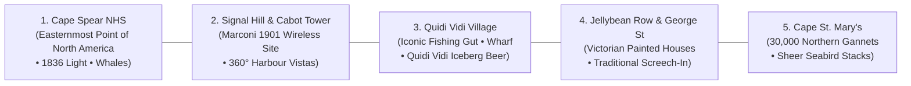

# Implementation Plan: 17-Day Expedition 51 (June 17 – July 3) Featuring St. John's, NL & Cape Spear

## 1. Goal Description

The user requested:
1. **Dates**: Depart **Wednesday, June 17** and return home **Friday, July 3** (**17 calendar days / 16 nights**).
2. **Destination Expansion**: **"Lets add St Johns NL"** — Expanding the itinerary east across the island of Newfoundland to include the historic capital city of **St. John's** and **Cape Spear** (the Easternmost point of North America).

This expansion transforms Expedition 51 into a legendary continental coast-to-coast traverse: from the subarctic wilderness of Labrador to the absolute eastern edge of the North American continent, before looping through Cape Breton's Cabot Trail, Prince Edward Island (Anne of Green Gables), and the Bay of Fundy.

---

## 2. The 17-Day Master Expedition Calendar (June 17 – July 3)

```mermaid
flowchart TD
    subgraph Leg1["Leg 1: Subarctic Boreal & Summer Solstice"]
        D1["Day 1: Wed Jun 17 • Hanmer -> Mirabel, QC (572 km)"]
        D2["Day 2: Thu Jun 18 • Mirabel -> Baie-Comeau, QC (642 km)"]
        D3["Day 3: Fri Jun 19 • QC-389 -> Labrador City, NL (567 km)"]
        D4["Day 4: Sat Jun 20 • SOLSTICE (17.5h Sun): Lab City -> Goose Bay (530 km)"]
        D5["Day 5: Sun Jun 21 • TLH-510 -> Blanc-Sablon (615 km)"]
    end

    subgraph Leg2["Leg 2: Iceberg Alley, Gros Morne & St. John's"]
        D6["Day 6: Mon Jun 22 • ICEBERGS: Ferry -> St. Anthony -> Meadows (175 km)"]
        D7["Day 7: Tue Jun 23 • Viking Trail -> Rocky Harbour, Gros Morne (365 km)"]
        D8["Day 8: Wed Jun 24 • Gros Morne Fjord & Tablelands Exploration (120 km)"]
        D9["Day 9: Thu Jun 25 • Gros Morne -> TCH-1 East -> St. John's, NL (695 km)"]
        D10["Day 10: Fri Jun 26 • ST. JOHN'S: Cape Spear + Signal Hill + Quidi Vidi"]
    end

    subgraph Leg3["Leg 3: Maritime Atlantic & The Cabot Trail"]
        D11["Day 11: Sat Jun 27 • St. John's -> Argentia Ferry (or Central NL) -> Night Ferry"]
        D12["Day 12: Sun Jun 28 • Disembark NS -> Full Cabot Trail Loop -> Baddeck (345 km)"]
        D13["Day 13: Mon Jun 29 • Baddeck -> Hwy 6 -> Confederation Bridge -> Charlottetown (360 km)"]
    end

    subgraph Leg4["Leg 4: PEI, Fundy & Canada Day Homecoming"]
        D14["Day 14: Tue Jun 30 • PEI Anne Circuit -> Bridge -> Hopewell Rocks -> Alma (318 km)"]
        D15["Day 15: Wed Jul 1 • CANADA DAY: Fundy -> Saint John Valley -> Edmundston, NB (330 km)"]
        D16["Day 16: Thu Jul 2 • Edmundston -> Lévis -> A-50 Bypass -> Pembroke, ON (590 km)"]
        D17["Day 17: Fri Jul 3 • HOMECOMING: Pembroke -> Radar Rd -> Hanmer, ON (350 km)"]
    end

    Leg1 --> Leg2 --> Leg3 --> Leg4
```

---

## 3. What Adding St. John's Unlocks for the Expedition

Adding St. John's adds extraordinary, once-in-a-lifetime ADV motorcycle waypoints:

1. **Cape Spear National Historic Site (`47.5242° N, 52.6200° W`)**:
   * Standing at the **Easternmost point of North America** (`52°37' W`). You are closer to London, England than you are to Vancouver! 
   * Perched on jagged ocean sea cliffs, you can photograph your Multistrada V2S and Africa Twin at the continent's edge.
2. **Signal Hill National Historic Site (`47.5700° N, 52.6808° W`)**:
   * Overlooking the "Narrows" entrance to St. John's natural harbour. Where Guglielmo Marconi received the first transatlantic wireless message (letter "S" in Morse code) from Cornwall, England on December 12, 1901.
3. **Quidi Vidi Village & Brewery (`47.5819° N, 52.6789° W`)**:
   * A postcard-perfect historic fishing outport nestled in a narrow ocean inlet. Home of *Quidi Vidi Brewing Company*, world-famous for brewing **Iceberg Beer** with water harvested directly from 20,000-year-old Greenland icebergs!
4. **Jellybean Row & George Street**:
   * The steeply sloping streets lined with bright Victorian clapboard townhouses painted in lavender, yellow, and turquoise, followed by Newfoundland live folk music on George Street.
5. **Cape St. Mary's Ecological Reserve (`46.8239° N, 54.1950° W`)**:
   * Located on the Avalon Peninsula on the way to the Argentia Ferry. A 1 km coastal walk takes you to "Bird Rock"—a sheer 100-meter sea stack packed with over **30,000 nesting Northern Gannets**, murres, and kittiwakes.

---

## 4. Ferry Strategy from the Avalon Peninsula

To transit from St. John's to Nova Scotia without repeating 900 km of highway back to Port aux Basques:

### Option A (Recommended): Marine Atlantic Argentia $\rightarrow$ North Sydney Summer Ferry
* **Ferry Terminal**: Argentia, NL (`47.2961° N, 53.9878° W`), located just **131 km (1.5 hrs)** southwest of St. John's via Route 100.
* **The Crossing**: Overnight sailing (~16 hours, departs late afternoon, arrives North Sydney morning).
* **The Experience**: You board with your motorcycles, settle into a comfortable private 2-berth/4-berth sleeper cabin, dine on fresh Atlantic cod or vegetarian dishes in the dining room, sleep while crossing the Cabot Strait, and roll off the ramp in North Sydney ready to ride the Cabot Trail!

### Option B (Overland Contingency): Trans-Canada Highway $\rightarrow$ Port aux Basques Ferry
* If the seasonal Argentia sailing schedule is not running on Day 11, the route seamlessly adapts:
  * Day 10: St. John's & Cape Spear exploration.
  * Day 11: St. John's $\rightarrow$ Grand Falls-Windsor (425 km).
  * Day 12: Grand Falls-Windsor $\rightarrow$ Port aux Basques (460 km) $\rightarrow$ 7-hour overnight ferry to North Sydney.

---

## 5. Lodging & Dual-Octane Fuel Plan for St. John's Leg

### Lodging Profile:
* **St. John's Primary Hotel**: **Alt Hotel St. John's** (Waterfront, floor-to-ceiling harbor views, secure underground motorcycle parking, steps from restaurants).
* **St. John's Secondary Hotel**: **Sheraton Hotel Newfoundland** (Cavendish Square, historic Fort William site, heated pool, valet/secured parking).
* **St. John's Tertiary Park Camping**: **Pippy Park Campground** (Located directly on the edge of the city on rolling boreal hills, serviced sites, heated restrooms).

### 91-Octane Fuel Availability:
* **TCH-1 Corridor (Deer Lake $\rightarrow$ Grand Falls $\rightarrow$ Gander $\rightarrow$ Clarenville $\rightarrow$ St. John's)**:
  * `91 Octane: AVAILABLE ✅` at every major Irving Big Stop, Esso, and Shell station.
  * St. John's metro has ubiquitous 91 and 93 AKI premium fuel.
  * Zero octane anxiety for the Ducati Multistrada V2S.

---

## 6. Detailed 17-Stage Overview Table

| Stage | Date | Day Title & Route | Distance | 91 Octane Status | Weather & Highlights |
| :---: | :---: | :--- | :---: | :---: | :--- |
| **D1** | **Wed Jun 17** | **Hanmer $\rightarrow$ Mirabel / Saint-Jérôme, QC** | 572 km | `YES ✅` | 24°C / 13°C • Rapid highway transit avoiding Ottawa traffic |
| **D2** | **Thu Jun 18** | **Mirabel $\rightarrow$ Charlevoix $\rightarrow$ Baie-Comeau, QC** | 642 km | `YES ✅` | 20°C / 10°C • Estuary sea breeze; mandatory 91 fuel staging |
| **D3** | **Fri Jun 19** | **QC-389: Baie-Comeau $\rightarrow$ Labrador City, NL** | 567 km | `MIXED` (87 km 316)| 17°C / 5°C • 158 km gravel bypass; Gagnon ghost town; Fermont Wall |
| **D4** | **Sat Jun 20** | **☀️ SOLSTICE: Lab City $\rightarrow$ Goose Bay, NL** | 530 km | `YES ✅` (Hub) | **17.5h Daylight (MAX)** • Longest day of the year; midnight sun |
| **D5** | **Sun Jun 21** | **TLH-510: Goose Bay $\rightarrow$ Blanc-Sablon, QC** | 615 km | `TRANSFER 🚨` | 13°C / 4°C • 405 km zero-service gap; fuel transfer at km 240 |
| **D6** | **Mon Jun 22** | **🧊 ICEBERGS: Ferry $\rightarrow$ St. Anthony $\rightarrow$ Meadows** | 175 km | `YES ✅` (St. Anthony)| **Peak Iceberg Season (95%)** • Point Amour & Viking settlement |
| **D7** | **Tue Jun 23** | **Viking Trail South $\rightarrow$ Rocky Harbour, Gros Morne**| 365 km | `YES ✅` | 18°C / 7°C • Western Brook Pond fjord & coastal arches |
| **D8** | **Wed Jun 24** | **Gros Morne Fjord & Tablelands Exploration** | 120 km | `YES ✅` | 18°C / 8°C • Earth's exposed mantle; Trout River sheep cliffs |
| **D9** | **Thu Jun 25** | **Gros Morne $\rightarrow$ TCH-1 East $\rightarrow$ St. John's, NL** | 695 km | `YES ✅` | 19°C / 9°C • Cross-island transit via Gander & Terra Nova NP |
| **D10**| **Fri Jun 26** | **St. John's & Cape Spear (Easternmost Point of NA)**| 80 km | `YES ✅` | 18°C / 10°C • Cape Spear lighthouse, Signal Hill, Quidi Vidi |
| **D11**| **Sat Jun 27** | **St. John's $\rightarrow$ Cape St. Mary's $\rightarrow$ Argentia Ferry**| 185 km | `YES ✅` | 16°C / 8°C • 30,000 Gannets at Bird Rock; 16-hr overnight sleeper |
| **D12**| **Sun Jun 28** | **Disembark NS $\rightarrow$ Cabot Trail Loop $\rightarrow$ Baddeck** | 345 km | `YES ✅` | 21°C / 11°C • Pure Cabot Trail: Skyline Trail & Neil's Harbour |
| **D13**| **Mon Jun 29** | **Baddeck $\rightarrow$ Hwy 6 $\rightarrow$ Bridge $\rightarrow$ Charlottetown, PEI**| 360 km | `YES ✅` | 22°C / 12°C • Sunrise Trail & Confederation Bridge into PEI |
| **D14**| **Tue Jun 30** | **PEI Anne Circuit $\rightarrow$ Bridge $\rightarrow$ Hopewell $\rightarrow$ Alma** | 318 km | `YES ✅` | 20°C / 10°C • Green Gables, Lovers' Lane, The Handpie Co, Fundy NP |
| **D15**| **Wed Jul 1**  | **🇨🇦 CANADA DAY: Fundy $\rightarrow$ Edmundston, NB** | 330 km | `YES ✅` | 23°C / 12°C • Hartland Covered Bridge; Canada Day in NB valley |
| **D16**| **Thu Jul 2**  | **Edmundston $\rightarrow$ Lévis $\rightarrow$ A-50 $\rightarrow$ Pembroke, ON** | 590 km | `YES ✅` | 25°C / 13°C • St. Lawrence South Shore & Laurentian foothills bypass |
| **D17**| **Fri Jul 3**  | **HOMECOMING: Pembroke $\rightarrow$ Radar Rd $\rightarrow$ Hanmer, ON**| 350 km | `YES ✅` | **MISSION COMPLETE**: 4671 Dupuis Dr finish! Weekend to rest. |

---

## 7. Implementation & Verification Plan

### Deliverables to Update:
1. **`road_tracks.json`**: Generate road-snapped tracks for all 17 stages (including Gros Morne to St. John's, St. John's local circuit, and Argentia / Edmundston legs).
2. **`east_coast_adv_pois.csv`**: Add St. John's, Cape Spear, Signal Hill, Quidi Vidi, Cape St. Mary's, and new lodging/fuel POIs.
3. **`expedition_51_itinerary.html` & `index.html`**:
   - Expand to 17 day cards (`day-card-1` through `day-card-17`).
   - Add historical weather profiles and Open-Meteo live satellite feeds for St. John's, Edmundston, and all 17 destinations.
   - Update map toolbar status badge to reflect 17 stages.
4. **GPX & KML Files**: Regenerate `east_coast_adv_loop.gpx` and `east_coast_adv_loop.kml` with all 17 road-snapped tracks.
5. **DOM Verification**: Run `python scratch/verify_html_divs.py` to ensure `Diff = 0` and section hierarchy is maintained.

---

## User Review Required

> [!IMPORTANT]
> **Approval Checklist**:
> 1. **Route Scope**: Do you approve expanding the expedition to **17 days (June 17 – July 3)** featuring **St. John's, Cape Spear (Easternmost point of North America), and Signal Hill**?
> 2. **Ferry Plan**: We target the **Argentia $\rightarrow$ North Sydney overnight ferry** on Day 11, with the overland return via Port aux Basques as the verified contingency.
> 
> Once approved, I will generate the road-snapped tracks, POIs, weather feeds, and HTML updates!
