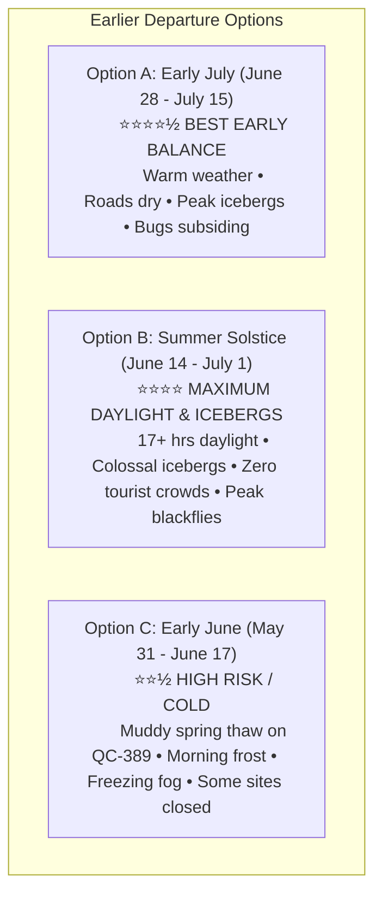

# Implementation Plan: Earlier Departure Options & Dynamic Season Weather

## 1. Goal Description

The user wants to explore earlier departure options for Expedition 51 (prior to the late July/August baseline) and integrate historical and live weather into the feed. 

This document evaluates the trade-offs of departing in **Early June**, **Mid/Late June (Summer Solstice)**, and **Early July**, details the specific environmental impacts on dual-sport motorcycle riding (Honda Africa Twin & Ducati Multistrada V2S), and proposes an interactive **Departure Season Selector** for the itinerary feed that dynamically updates the historical climatology and riding gear advice for each stage.

---

## 2. Earlier Departure Options: Multi-Factor Comparative Analysis



### Comprehensive Comparison Matrix:

| Factor | Option A: Early July<br/>*(June 28 – July 15)* | Option B: Summer Solstice<br/>*(June 14 – July 1)* | Option C: Early June<br/>*(May 31 – June 17)* | Option Baseline: Late July/Aug<br/>*(July 25 – Aug 18)* |
| :--- | :--- | :--- | :--- | :--- |
| **🏆 Iceberg Density** | **Phenomenal**: Giant icebergs in St. Anthony, Twillingate, and Point Amour. | **ABSOLUTE PEAK**: Colossal cathedral icebergs line Iceberg Alley. | **Maximum Ice**: Icebergs + pack ice in Strait of Belle Isle. | **Low**: Most icebergs melted into small bergy bits. |
| **🛣️ QC-389 Gravel (158 km)** | **Packed & Dry**: Spring grading completed; firm, fast surface. | **Mostly Good**: Grading active; occasional loose crushed stone/damp sections. | **Challenging**: Soft mud / thaw ruts ("dégel"); sharp frost rocks exposed. | **Optimal**: Firm, smooth, dust-suppressed packed gravel. |
| **🦟 Bug Pressure (Labrador)** | **Moderate**: Blackflies starting to decline; mosquitoes active at dusk. | **PEAK BLACKFLY SEASON**: Aggressive swarms in woods when stopped. | **Emerging**: Blackflies hatching as water warms. | **Low / Minimal**: Blackfly season completely over. |
| **☀️ Daylight Hours** | **16.5 Hours**: Dusk past 9:30 PM. | **17.5 Hours (MAX)**: Dawn 4:15 AM, dusk 10:15 PM in Labrador. | **16.5 Hours**: Long daylight. | **15 Hours**: Shorter evenings (dusk by 8:45 PM). |
| **🌡️ Daytime Temps (South)** | **24°C–27°C (75°F–81°F)** | **21°C–25°C (70°F–77°F)** | **18°C–22°C (64°F–72°F)** | **24°C–28°C (75°F–82°F)** |
| **❄️ Nighttime Temps (Labrador)**| **8°C–12°C (46°F–54°F)** | **4°C–8°C (39°F–46°F)** | **0°C–4°C (32°F–39°F)** *(Frost risk)* | **9°C–13°C (48°F–55°F)** |
| **👥 Tourist Density** | **Moderate**: PEI & Cabot Trail getting busy. | **Very Low**: Empty roads, quiet national parks. | **Virtually None**: You have the highway to yourselves. | **Peak**: Busy summer season in PEI & Cabot Trail. |
| **🎟️ Ferry & Room Booking** | **High Demand**: Canada Day week books early. | **Moderate**: Much easier cabin availability. | **Wide Open**: Plenty of last-minute flexibility. | **Severe**: Sleeper cabins & Gros Morne sell out 8+ mo ahead. |
| **🏛️ Seasonal Site Openings** | **100% Open**: All outport chowder sheds, Anne sites, ferries operating. | **95% Open**: Anne sites open; most coastal shacks open by mid-June. | **Partial (75%)**: Some seasonal B&Bs, boat tours, and sheds closed until mid-June. | **100% Open**: Full peak season operations. |

---

## 3. Deep Dive into the Top 2 Earlier Options

### 🥇 Option A: "Canada Day / Early July Window" (Departing ~June 28 – July 5)
* **Verdict**: **The Sweet-Spot Earlier Option**.
* **Why It Works Best**:
  1. **Road Surface**: The Quebec Ministry of Transport (`MTQ`) concludes spring thaw weight limits ("période de dégel") on QC-389 by early June. By late June/early July, the 158 km unpaved bypass has been graded at least once, creating firm, hard-packed dual-sport riding with minimal mud.
  2. **The Iceberg Grand Slam**: You get the best of both worlds—comfortable summer riding temperatures AND active iceberg sightings off the northern tip of Newfoundland and Labrador.
  3. **Manageable Bugs**: While bug jackets are still required when stopping on TLH-500/510, blackfly populations begin their steep downward trend by early July.
  4. **Anne of Green Gables & PEI**: Cavendish and Park Corner are in full bloom; the Charlottetown *Anne of Green Gables: The Musical* has opened its summer run.

### 🥈 Option B: "The Solstice / Iceberg Hunter Window" (Departing ~June 14 – June 20)
* **Verdict**: **For Riders Who Prioritize Colossal Icebergs & Midnight Sun**.
* **Why Riders Choose It**:
  1. **Iceberg Alley in Full Glory**: Icebergs are at their absolute most dramatic size and density. Riding your motorcycle out onto the Cape Norman gravel spit or Point Amour and seeing 150-foot turquoise ice towers grounded offshore is an unforgettable bucket-list visual.
  2. **17.5 Hours of Daylight**: Near the solstice (June 20), western Labrador never gets pitch-black—nautical twilight lingers all night. You can ride relaxed, never racing sundown.
  3. **Zero Crowds**: Cabot Trail, Skyline Trail, Gros Morne Tablelands, and Green Gables are serene, with no tour buses or camper van traffic jams.
* **The Necessary Precautions**:
  * **Blackfly Defense**: You **must** pack bug jackets with fine noseeum head netting and high-concentration icaridin/DEET in your tank bags. Never leave visors cracked when refueling in Churchill Falls or Port Hope Simpson.
  * **Heated Riding Gear / Thermal Layers**: Nighttime temperatures in Labrador City and Churchill Falls hover around 3°C–6°C (37°F–43°F). Both the Multistrada and Africa Twin have heated grips, but thermal base layers and windproof jackets are mandatory for early morning launches.

---

## 4. Proposed Dynamic Weather Feature in the Feed

To give the user complete visibility whether departing in **Early Summer (June/Early July)** or **Mid Summer (July/August)**, we will build a **Departure Window Selector** directly inside the feed toolbar:

```
┌────────────────────────────────────────────────────────────────────────┐
│ 🌤️ CLIMATOLOGY PROFILE:  [ June (Solstice) ]  [ Early July ]  [ Aug ]  │
└────────────────────────────────────────────────────────────────────────┘
```

When toggled, the historical weather section in all 15 day cards will dynamically update:
1. **Historical High / Low**: Shows the exact temperatures for the selected month (e.g. Labrador City: June High 16°C / Low 4°C vs July High 21°C / Low 9°C).
2. **Iceberg & Wildlife Indicator**: Highlights iceberg sighting probability for that stage (e.g. St. Anthony: June 95% 🧊 vs August 15%).
3. **Blackfly / Bug Severity Meter**: E.g. June: `⚠️ Severe (Head nets mandatory)` vs August: `🟢 Low (Negligible)`.
4. **Gravel & Road Surface Status**: E.g. June: `Grading active, damp sections` vs August: `Dry, hard-packed`.
5. **Live Actual Weather (Open-Meteo)**: Always active regardless of season, streaming real-time live temperatures, wind speed, and precipitation for riders currently on the road.

---

## 5. Implementation Strategy

1. **Phase 1: Weather Engine Integration (`Open-Meteo` + Multi-Month Climatology Database)**:
   - Compile 30-year climate normals for June, July, and August across all 15 destination waypoints.
   - Implement asynchronous Open-Meteo fetcher for live destination weather.
2. **Phase 2: Day-Card Weather Module in Feed**:
   - Inject the weather card into every day card in [`expedition_51_itinerary.html`](file:///C:/Users/Jamie/Desktop/Expedition%2051/expedition_51_itinerary.html) and [`index.html`](file:///C:/Users/Jamie/Desktop/Expedition%2051/index.html).
   - Add the interactive Month Toggle buttons at the top of the feed (`[June Solstice]`, `[Early July]`, `[Peak August]`).
3. **Phase 3: Verification & Div Balancing**:
   - Run `python scratch/verify_html_divs.py` to ensure `Diff = 0` and section hierarchy remains strictly verified.
   - Synchronize all files between Desktop and Brain directory.

---

## User Review Required

> [!IMPORTANT]
> **Which earlier window appeals to you most?**
> 1. **Early July (June 28 – July 15)**: Mild summer temps, dry roads, bug pressure dropping, excellent iceberg sightings, full attractions open. *(Recommended earlier balance)*
> 2. **Summer Solstice (June 14 – July 1)**: Maximum icebergs, 17.5 hours daylight, zero crowds, but requires bug head nets and thermal layers for cooler subarctic mornings.
>
> Once you choose your preferred window (or if you want the interactive month toggle that shows all of them), I will proceed to implement the weather feeds and live API engine.
