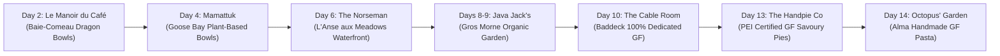

# Expedition 51: Gluten-Free & Vegetarian Dining Field Guide
### Tailored Culinary & Provisioning Strategy for 17-Day West Coast Viking & Split Cabot Trail Loop
### June 17 – July 3, 2026

> **Rider Profile**: Two-up expedition (Ducati Multistrada V2S & Honda Africa Twin).  
> **Dietary Protocol**: **100% Gluten-Free AND Vegetarian** (No gluten/wheat, no meat, poultry, fish, or seafood).

---

## 1. Executive Summary & The "Pannier Kitchen" Strategy

Traveling through northern Quebec (QC-389), the Trans-Labrador Highway (TLH 500 & 510), and the Great Northern Peninsula of Newfoundland requires proactive planning for a **Gluten-Free + Vegetarian** diet. In remote northern roadhouses, the standard fare is almost exclusively fried fish & chips, deli meat, burgers, and wheat-flour gravy poutine. 

### Three Golden Rules for Remote ADV Dining:
1. **Never Rely on Remote Gas Outposts for Meals**: Outposts like **Relais Gabriel (Km 316)** and **Port Hope Simpson** have virtually zero gluten-free vegetarian food (beyond chips and candy). Carry emergency freeze-dried meals and snacks in your panniers.
2. **Beware the "Fish is Vegetarian" Coastal Assumption**: In coastal Newfoundland, Labrador, and the Maritimes, servers frequently ask if fish or seafood is fine. Always specify: *"No meat, no poultry, no fish, and no seafood."*
3. **Beware Shared Deep Fryers**: In roadside diners, French fries are nearly always fried in the same oil as battered cod and onion rings. Always ask if they have a **dedicated gluten-free fryer**; if not, opt for baked potatoes, steamed rice, or salads.

---

## 2. Essential Pannier Provisions & Resupply Supermarkets

Before leaving civilization, dedicate one side pannier dry bag to shelf-stable, certified GF + vegetarian provisions.

### Recommended Packable Rations:
* **Freeze-Dried Meals (Add Boiling Water via Jetboil)**:
  * **Nomad Nutrition** (*Canadian brand, 100% plant-based, gluten-free, non-GMO*): Kathmandu Curry, Hungarian Goulash, Irish Stew, Spanish Paella.
  * **Backpacker's Pantry**: Pad Thai (GF/Vegan), Chana Masala.
  * **AlpineAire**: Sweet & Sour Rice with Vegetables.
* **Trail Fuel & Protein**:
  * Individual nut butter packets (Justin's almond/peanut butter).
  * Roasted seasoned chickpeas (Biena / The Good Bean).
  * High-protein GF snack bars (GoMacro, RXBAR Plant, MadeGood).
  * Hard cheeses (Aged white cheddar, Gouda — travel well without refrigeration for 2–3 days).
  * Certified GF tortillas/wraps (Toufayan) + squeeze pouches of guacamole/hummus.

### Major Grocery Resupply Hubs Along Route:
| Stage | Town | Recommended Supermarket | Provisions to Stock |
| :--- | :--- | :--- | :--- |
| **Day 1** | Pembroke / Hawkesbury | **Metro / Independent Grocer** | Fresh picnic produce, GF crackers, cheese. |
| **Day 2** | Baie-Comeau, QC | **IGA Extra** (Blvd Laflèche) | Last major Quebec grocery before 1,300 km of wilderness. Stock GF bread, fruit, trail mix. |
| **Day 3** | Labrador City, NL | **IGA Extra / Walmart** (Labrador Mall) | Fresh fruit, GF snacks, protein shakes, nuts before the TLH run to Goose Bay. |
| **Day 4** | Goose Bay, NL | **Terrington Consumer Co-op** | Crucial resupply before the remote 405 km wilderness stretch on Route 510. |
| **Days 8–9** | Rocky Harbour, NL | **Foodland Rocky Harbour** | Fresh produce, trail snacks for Gros Morne hiking days. |
| **Day 10** | Baddeck, NS | **Baddeck Co-op Food Store** | Local Nova Scotia fruit, cheeses, GF crackers for Cabot Trail lookouts. |
| **Day 13** | Charlottetown / Borden, PEI | **Riverview Country Market / Sobeys** | World-class PEI potatoes, fresh berries, local artisan GF baked goods. |
| **Day 15** | Edmundston, NB | **Superstore Edmundston** | Fresh camp supplies and trail provisions for Quebec return leg. |

---

## 3. Day-by-Day Recommended Dining Guide

### Leg 1: Ontario to the St. Lawrence Shoreline

#### Day 1 (Jun 17): Hanmer, ON $
ightarrow$ Ottawa River / Voyageur Provincial Park, ON
* **Lunch on Route (Ottawa Valley / Pembroke area)**:
  * **Zaytouna Mediterranean Bistro** (183 Pembroke St W, Pembroke) — Peak-season produce, roasted vegetables, rice and quinoa grain bowls, fresh Mediterranean salads.
  * **Nomada Tacos** (205 Church St, Pembroke) — Authentic corn tortilla tacos with customized black bean and roasted vegetable fillings.
* **Dinner at Voyageur Provincial Park / Hawkesbury Area**:
  * Campfire dinner or fresh grocery picnic: artisan GF bread, local cheeses, olives, fresh salads, and fruit overlooking the Ottawa River.

#### Day 2 (Jun 18): Voyageur PP $
ightarrow$ Tadoussac Ferry $
ightarrow$ Baie-Comeau, QC
* **Lunch Stop (Charlevoix / Tadoussac)**:
  * **Boulangerie À Chacun son Pain** (Baie-Saint-Paul) — Artisan salads, gluten-free treats, and fresh espresso overlooking the Charlevoix hills.
  * **Café Bohème** (Tadoussac) — Beautiful village bistro featuring hearty vegetarian ratatouille, local goat cheese salads, and GF adaptations.
* **Dinner in Baie-Comeau (Overnight)**:
  * **Le Manoir du Café** (5 Place La Salle) — **Top Pick in Baie-Comeau!** Charming bistro serving fresh vegetarian dragon bowls, tofu poke bowls, and composed salads with homemade vinaigrettes.
  * **Resto-Bar Le Blues** (Place La Salle) — Can prepare grilled vegetable skewers, large Greek salads (sans croutons), and baked potatoes upon request.

---

### Leg 2: Quebec Route 389 & The Trans-Labrador Highway

#### Day 3 (Jun 19): Baie-Comeau $
ightarrow$ Manic-5 $
ightarrow$ Labrador City, NL
* **Lunch on QC-389**:
  * ⚠️ **WARNING**: **Relais Gabriel (Km 316)** has zero reliable GF+vegetarian food. Bring your Jetboil and prepare a hot Nomad Nutrition curry or packed GF sandwich prepared that morning in Baie-Comeau.
  * Manic-5 (Daniel-Johnson Dam cafeteria) has basic fruit, yogurt, and chips.
* **Dinner in Labrador City / Wabush (Overnight)**:
  * **Sir Hercules Lounge / Hotel Wabush** — Custom salads, baked potatoes, steamed seasonal vegetables, and rice pilaf.
  * **Pizza Delight (Labrador City)** — Offers a certified **Cauliflower Gluten-Free Crust** with vegetable toppings and garden salads.
  * **Pho Labrador** (Labrador City) — Fresh rice noodle vegetarian pho (clarify vegetable broth) and fresh spring rolls with peanut dipping sauce.

#### Day 4 (Jun 20): Trans-Labrador Hwy 500 $
ightarrow$ Happy Valley-Goose Bay, NL
* **Lunch in Churchill Falls (Km 238)**:
  * **Churchill Falls Inn Dining Room** — Classic remote northern roadhouse. Safe order: baked potato (butter & sour cream), steamed vegetable medley, and garden salad with oil and vinegar. (Or enjoy a hot Jetboil meal in the park by the river).
* **Dinner in Happy Valley-Goose Bay (Overnight)**:
  * **Mamattuk Restaurant** (2C Tenth Street — adjacent to Royal Inn & Suites) — **The Culinary Crown Jewel of Labrador!** Celebrates northern farm and wild berry cuisine with explicit accommodations for **gluten-free, dairy-free, and vegetarian** diets. Features creative plant-based bowls, local root vegetables, and fresh berry coulis.
  * **Jungle Jim's Eatery** (at Hotel North Two) — Backup option with a gluten-sensitive menu: *Seven Veggie Stir Fry* (rice-based) or *Viva Las Vegan Bowl* (black beans, corn, peppers, guacamole over rice).

#### Day 5 (Jun 21): Route 510 Wilderness $
ightarrow$ Blanc-Sablon / L'Anse-au-Clair, NL
* **Lunch on Route 510**:
  * ⚠️ **WILDERNESS STAGE**: 405 km from Goose Bay to Port Hope Simpson. Pull out at a scenic river crossing and enjoy a packed GF picnic with trail nuts, cheese, and fruit.
* **Dinner in L'Anse-au-Clair / Blanc-Sablon**:
  * **Jungle Jim's at the Northern Light Inn** (L'Anse-au-Clair) — Offers the *Viva Las Vegan Bowl*, *Seven Veggie Stir Fry*, baked potatoes, and Greek salads.
  * **The Anchor Café** (L'Anse-au-Clair) — Family-run coastal café serving home-style potato leek soup (verify no flour roux), fresh garden salads, and local berry desserts.

---

### Leg 3: Newfoundland Viking Trail & Gros Morne National Park

#### Days 6 & 7 (Jun 22–23): L'Anse aux Meadows & Cape Onion, NL
* **Lunch in St. Anthony**:
  * **Lightkeeper's Seafood / Fishing Point Café** — Perched dramatically on the cliff overlooking Iceberg Alley. Order the garden salad, baked potato, or steamed vegetable plate while watching icebergs drift by.
* **Dinner in L'Anse aux Meadows**:
  * **The Norseman Restaurant** (Harbourfront, L'Anse aux Meadows) — **Outstanding Dining Experience!** High-end seaside restaurant that explicitly caters to vegetarian and gluten-free guests. Enjoy fresh organic arugula salads with goat cheese, seasonal vegetable risotto, and house-made wild berry coulis while watching the sunset over the Viking settlement.
  * **Snorri Cabins Kitchenette**: Prepare private hot camp meals on the ocean deck overlooking Sacred Bay.

#### Days 8 & 9 (Jun 24–25): Gros Morne National Park (Rocky Harbour & Green Point)
* **Breakfast & Lunch in Rocky Harbour**:
  * **Java Jack’s Restaurant & Gallery** (88 Main St N, Rocky Harbour) — **Must-Visit!** Features an on-site organic garden. Famous for massive roasted beet & almond salads, creative tofu & vegetable creations, and dedicated gluten-free accommodations.
* **Dinner in Rocky Harbour / Norris Point**:
  * **The Black Spruce Restaurant** (Neddies Harbour Inn, Norris Point) — Premier fine-dining eco-bistro in Gros Morne. Specializes in local organic vegetables, vegan/vegetarian tasting courses, and rigorous allergy-safe protocols.
  * **Ocean View Hotel Dining Room** (Rocky Harbour) — Solid fallback for gluten-friendly vegetable stir-fries, baked potatoes, and live local Newfoundland folk music.
  * **Green Point Clifftop Campfire**: Roast baked potatoes and fresh corn over driftwood embers right beside the crashing Atlantic surf.

---

### Leg 4: Cape Breton Island & The Cabot Trail

#### Day 10 (Jun 26): Gros Morne $
ightarrow$ Port aux Basques Ferry $
ightarrow$ North Sydney KOA
* **Lunch Stop in Corner Brook**:
  * **Newfound Sushi** (Corner Brook) — Outstanding spot for vegetarian gluten-free sushi rolls (avocado, cucumber, asparagus rolls with tamari/GF soy sauce).
  * **Sorrento Bistro** (Corner Brook) — Offers gluten-free pasta and vegetable-loaded salads.
* **Ferry Crossing (Marine Atlantic MV Highlanders / Blue Puttees)**:
  * ⚠️ Pick up takeout salads and GF snacks in Corner Brook to enjoy comfortably during the 6-hour daytime crossing.
* **Dinner in North Sydney / Baddeck**:
  * **The Cable Room at The Telegraph House** (Baddeck) — **THE ULTIMATE HIGHLIGHT! A 100% Dedicated Gluten-Free Commercial Kitchen!** Zero cross-contamination risk for celiacs. Prominently features vegetarian dishes such as the *Field of Greens* salad with maple-glazed walnuts, roasted root vegetables, and artisan cheese plates.

#### Days 11 & 12 (Jun 27–28): The Cabot Trail (Ingonish & Chéticamp)
* **Cabot Trail Dining Highlights**:
  * **The Dancing Goat Café & Bakery** (Margaree Valley) — Renowned stop along the Cabot Trail for fresh artisan salads, vegetarian soups, and daily GF baked treats.
  * **L'Auberge Doucet / Laurie's** (Chéticamp) — Acadian hospitality with customized vegetable omelets, fresh salads, and boiled local potatoes.
  * **Meat Cove Chowder Hut**: Clifftop overlook serving hot coffee, fresh berry pies, and salads.
  * **Chéticamp Campfire / Seaside Picnic**: Fresh Acadian berries and local artisan provisions.

---

### Leg 5: PEI, Bay of Fundy & Ontario Return Corridor

#### Day 13 (Jun 29): Chéticamp $
ightarrow$ Caribou Ferry $
ightarrow$ Borden / Summerside KOA (PEI)
* **Dining on PEI**:
  * **The Handpie Company** (Albany, PEI — right near Borden KOA!) — Offers delicious certified **Gluten-Free Savory Pies** (corn, black bean & cheese, roasted vegetable).
  * **Cedar's Eatery** (Charlottetown) — Famous Lebanese bistro featuring gluten-free falafel, hummus, babaganoush, and tabouleh adaptations.

#### Day 14 (Jun 30): Confederation Bridge $
ightarrow$ Hopewell Rocks $
ightarrow$ Fundy National Park, NB
* **Lunch en route (Moncton area)**:
  * **Calactus Vegetarian Restaurant** (Moncton) — One of Eastern Canada's most celebrated 100% vegetarian restaurants! Abundant gluten-free bowls, salads, and fresh juices.
* **Dinner in Alma (Fundy National Park Gateway)**:
  * **An Octopus’ Garden Café & Bistro** (8561 Main St, Alma) — **Top Pick in Alma!** Charming scratch bistro with fantastic vegan/vegetarian burrito bowls, crisp local salads, and **gluten-free handmade pasta** options.
  * **Tides Restaurant (Parkland Village Inn)** — Chef accommodates GF and vegetarian requests with fresh seasonal vegetable medleys, rice dishes, and seaside hospitality.

#### Day 15 (Jul 01): Alma $
ightarrow$ Fundy Trail Parkway $
ightarrow$ Edmundston, NB (Canada Day)
* **Dinner in Edmundston (Overnight)**:
  * **Frank's Bar & Grill** (Four Points by Sheraton, 100 Rue Rice) — Grilled vegetable skewers, quinoa harvest bowls, certified GF burgers, fresh salads.
  * **Café Flora** (Edmundston downtown) — Botanical garden cafe with scratch-made menu, vegetarian wraps, GF grain bowls, and fresh fruit smoothies.

#### Day 16 (Jul 02): Edmundston $
ightarrow$ Lévis Bypass $
ightarrow$ Renfrew KOA, ON
* **Lunch Stop (Rivière-du-Loup / Bas-Saint-Laurent)**:
  * **Café de la Brûlerie** (Rivière-du-Loup) — Perched over the waterfalls, offering hearty quinoa bowls, fresh salads, and gluten-free adaptations.
* **Dinner in Pembroke / Renfrew**:
  * **The Courtyard Bistro** (66 Pembroke St W, Pembroke) — Fine seasonal bistro with excellent vegetarian entrees and gluten-friendly adaptations.
  * **Boston Pizza (Pembroke / Renfrew)** — Reliable standby with their certified **GlutenWise®** menu (individual gluten-free cauliflower crust pizzas and vegetarian pastas).

#### Day 17 (Jul 03): Renfrew $
ightarrow$ Highway 17 West past North Bay $
ightarrow$ Hanmer Home Base
* **Final Lunch Stop in North Bay**:
  * **The Green Cocoa Co.** (North Bay) — Dedicated gluten-free and vegan bakery/café with hearty lunchtime savory pies, wraps, and soups.
  * **Twiggs Coffee Roasters** (Hwy 17 / North Bay) — Fresh gluten-free grain bowls, veggie wraps, and fresh-roasted coffee before the final 90-minute ride home to 4671 Dupuis Drive.

---

## 4. French-Language Dining Cheat Sheet for Quebec

Print or screenshot these key phrases for smooth ordering in Quebec and the French-speaking Lower North Shore:

| English Phrase | French Translation | Pronunciation Guide |
| :--- | :--- | :--- |
| "My wife is gluten-free and vegetarian." | *"Ma femme mange sans gluten et végétarien."* | *mah fam mahnj saw gloo-ten ay vay-zhay-tahr-ee-en* |
| "No meat, no poultry, no fish, and no seafood, please." | *"Sans viande, sans poulet, sans poisson, et sans fruits de mer, s'il vous plaît."* | *saw vee-ahnd, saw poo-lay, saw pwah-sohn, ay saw fwee duh mair, seel voo play* |
| "Does this sauce contain wheat flour?" | *"Est-ce que cette sauce contient de la farine de blé?"* | *es-kuh set sohs kon-tee-en duh lah fah-reen duh blay?* |
| "Do you have a dedicated fryer for gluten-free?" | *"Avez-vous une friteuse dédiée sans gluten?"* | *ah-vay voo oon free-tuhz day-dee-ay saw gloo-ten?* |
| "Can this dish be made with rice or baked potato instead of bread/fries?" | *"Est-ce possible d'avoir du riz ou une pomme de terre au four à la place du pain ou des frites?"* | *es pos-eeb-luh dah-vwahr doo ree oo oon pum duh tair oh foor ah lah plahs...* |

---

## 5. Summary of Top Culinary Highlights for Her

