# Expedition 51: Daily Saddle Time, Fuel Logistics & Pacing Protocols
### 18-Day Master Itinerary • Wednesday, June 16 – Saturday, July 3, 2027 • ~7,871 km
### Precise Daily Schedules • 7:00 AM Standard Start • Relative Timing & Saddle Durations

---

## 1. Fleet Fuel Dynamics & Range Benchmarks

| Metric | Lead Tanker: 2025 Honda Africa Twin Adventure Sports ES DCT | Sport ADV: 2026 Ducati Multistrada V2S | Operational Rule & Protocol |
| :--- | :---: | :---: | :--- |
| **Engine & Compression** | 1084cc Twin • 10.5:1 Compression | 937cc Testastretta 11° • 12.6:1 Compression | Ducati **MUST** run 91 AKI minimum to avoid premature pre-ignition knock. |
| **Fuel Grade Required** | **Regular 87 AKI** | **Premium 91 AKI Minimum** | Africa Twin safely digests remote 87 fuel; Ducati requires 91 or chemical boost. |
| **Onboard Fuel Tank** | **24.8 Liters (6.55 US Gal)** | **20.0 Liters (5.28 US Gal)** | Ducati tank is the limiting factor for stage range. |
| **Auxiliary Fuel Carried** | **15.1 Liters (4.0 US Gal)** *(11.4L Giant Loop Armadillo + 3.7L Rotopax)* | **0.0 Liters** *(Relying on Lead Tanker escort)* | Africa Twin carries auxiliary fuel exclusively filled with **91 Premium** for the Ducati. |
| **Total Fuel Capacity** | **39.9 Liters (10.5 US Gal)** | **20.0 Liters (5.28 US Gal)** | Africa Twin acts as mobile tanker for remote wilderness corridors. |
| **Highway Consumption** | ~4.9 L / 100 km (48.0 mpg) | ~5.3 L / 100 km (44.4 mpg) | Paved open highway at 95–105 km/h cruise. |
| **Remote/Gravel Consumption** | ~5.2 L / 100 km (45.2 mpg) | ~5.6 L / 100 km (42.0 mpg) | QC-389, TLH 510, Meat Cove, elevation climbs. |
| **Comfortable Range Interval** | **480 km (Main Tank)** / **720+ km (Total)** | **250 – 280 km (Safe Touring Interval)** | Fuel stops scheduled every **160–250 km** (2.0–2.75h saddle time). |
| **Absolute Maximum to Dry** | 500 km (Main) / 780 km (Total) | 355 km (Highway) / 330 km (Remote) | Never push Ducati beyond 280 km without auxiliary reserve. |

---

## 2. Remote Fuel Desert & Octane Protocols

```mermaid
flowchart TD
    subgraph QC389["Sector 1: Quebec Route 389 (Baie-Comeau to Lab City - 601 km)"]
        A1["Baie-Comeau Shell V-Power
(Fill 100% Main + 15.1L Bladders with 91)"] -->|214 km / 3h 00m| A2["Manic-5 Fuel (Motel de l'Énergie)
(87 Octane ONLY - 12.0L used)"]
        A2 -->|Top up 87 + Dose 60ml Lucas Booster or Bladder| A3["Relais Gabriel (Km 316)
(87 Octane ONLY - 5.7L used)"]
        A3 -->|249 km / 3h 30m| A4["Fermont Shell / Lab City Ultramar
(Full 91 Premium Municipal Grid - 13.9L used)"]
    end

    subgraph TLH500["Sector 2: Trans-Labrador TLH 500 (Lab City to Goose Bay - 532 km)"]
        B1["Lab City Ultramar
(Fill 100% with 91 Premium)"] -->|238 km / 3h 00m| B2["Churchill Falls Gas & Convenience
(87 Reliable / 91 Rare - 13.3L used)"]
        B2 -->|Fill 87 + Dose 60ml Booster if 91 absent| B3["Happy Valley-Goose Bay Esso/Irving Hub
(294 km / 3h 40m - 16.5L used - 3.5L reserve)"]
    end

    subgraph TLH510["Sector 3: Trans-Labrador TLH 510 (Goose Bay to Blanc-Sablon - 628 km)"]
        C1["Goose Bay Esso/Irving
(MANDATORY: 100% Main Tanks + 15.1L 91 in Bladder)"] -->|240 km / 3h 00m| C2["Km 240 Mealy Mountains Overlook
(405 KM ZERO-SERVICE GAP MIDPOINT)"]
        C2 -->|BLADDER TRANSFER: Siphon 6.0-7.5L 91 into Ducati| C3["Port Hope Simpson Gas Bar (Km 405)
(87 Octane ONLY - 9.2L used)"]
        C3 -->|53 km / 40m| C4["Mary's Harbour North Atlantic
(Full 91 Premium Available! Top off Ducati)"]
        C4 -->|169 km / 2h 15m| C5["Blanc-Sablon Ultramar
(Full 91 Premium Ferry Staging Hub)"]
    end
```

### Chemical Octane Booster Dosing Protocol (Lucas Oil MMT Formula)
When 91 Premium is unavailable at remote pumps (Manic-5, Relais Gabriel, Churchill Falls, Port Hope Simpson):
* **Dosage Rate**: 2.08 ml per liter of fuel per octane number.
* **To Boost 87 AKI to 91 AKI (+4 numbers) in a 20L Tank**:
  $$\text{Required Dose} = 20\text{ L} \times 4 \times 2.08\text{ ml/L} \approx \mathbf{166.7\text{ ml (5.6 fl oz)}}$$
* **Partial Tank Top-up (10 Liters 87 Regular)**:
  $$\text{Required Dose} = 10\text{ L} \times 4 \times 2.08\text{ ml/L} \approx \mathbf{83.3\text{ ml (2.8 fl oz)}}$$
* **Execution**: Inject booster into tank **before** pumping fuel. The incoming fuel stream guarantees instantaneous molecular mixing.

---

## 3. Daily Pacing & Meal Rhythm Rules

1. **Standard 07:00 AM Daily Start**:
   * All non-ferry days commence at **07:00 AM** sharp.
   * **Breakfast**: **30 minutes** (07:00 – 07:30 AM) to eat, review weather, and pack bikes. Wheels roll at **07:30 AM**!
2. **Special Ferry Morning Adjustments**:
   * **Day 6 (Monday, June 21 - Blanc-Sablon to St. Barbe)**:
     * MV Qajaq W 08:00 AM sailing requires check-in at 07:00 AM.
     * **06:00 AM Wake-up** $
ightarrow$ **06:15 – 06:45 AM Breakfast** $
ightarrow$ **06:50 AM Rollout** to ferry slip (5 km / 6 min).
   * **Day 11 (Saturday, June 26 - Marine Atlantic Overnight Ferry Disembarkation)**:
     * MV Highlanders docks in North Sydney at **07:00 AM**.
     * **06:00 AM Wake-up** in stateroom $
ightarrow$ **06:15 – 06:45 AM Breakfast** in ship cafeteria $
ightarrow$ **07:00 AM Ramp Rollout** directly onto the Cabot Trail!
3. **Midday Lunch & Fuel Rhythm**:
   * **Lunch**: **30 minutes** scheduled between 12:00 PM and 01:15 PM, combined with a gas stop to minimize lost time.
4. **Evening Arrival & Supper**:
   * **Supper**: **1 hour** scheduled between 06:00 PM and 07:30 PM after check-in, tent pitch, and bike fuel top-off.
5. **In-the-Saddle Intervals**:
   * Highway legs are capped at **2h 00m to 2h 45m** between stops (~160–250 km).
   * Remote gravel/winding legs are capped at **3h 00m** maximum.

---

## 4. Day-by-Day Schedules, Saddle Times & Fuel Log (Days 1–18)

### Day 01: Day 1: Hanmer Home Base to Mirabel, QC
* **Date**: Wednesday, June 16, 2027
* **Total Distance**: **648.7 km** | **Saddle Time**: **7.9h** | **Stops & Meals**: **2.2h** | **Total Elapsed**: **10.1h**
* **Daily Timing Profile**: Wake: `07:00 AM` | Rollout: `07:30 AM` | Destination Arrival: `05:05 PM` | Supper: `06:00 - 07:00 PM`
* **Overnight Lodging**: Motel au P'tit Sapin, Mirabel, QC

| Leg & Route Description | Distance | Saddle Time | Dep / Arr Timestamps | Activity & Stop Duration | Primary Gas Station (91/87) | Backup Gas Station | Ducati Fuel Used & Reserve |
| :--- | :---: | :---: | :---: | :--- | :--- | :--- | :---: |
| **Leg 1: Hanmer to Deep River & Pembroke** *Hwy 17 East past North Bay & Mattawa to Pembroke* | **245 km** | **2h 45m** | Dep: `07:30 AM` Arr: `10:15 AM` | Primary Gas Stop #1 & stretch (20m) | Pembroke Esso / Circle K (45.8267, -77.1111) - 91: YES | Petawawa Shell (Km 228) or Deep River Canadian Tire Gas+ (Km 215) | 13.0L used (7.0L (35% reserve)) |
| **Leg 2: Pembroke across Ottawa River to Masson-Angers** *Hwy 17 to Chenaux Dam -> Portage-du-Fort -> Route 148 East through Shawville & Aylmer -> Gatineau -> Angers* | **195 km** | **2h 25m** | Dep: `10:35 AM` Arr: `01:00 PM` | Primary Gas Stop #2 + 30m LUNCH (45m) | Masson-Angers Shell / Ultramar (45.5422, -75.4280) - 91: YES | Shawville Petro-Canada (Km 60 into leg) or Thurso Ultramar (Km 15 east) | 10.3L used (9.7L (48% reserve)) |
| **Leg 3: Masson-Angers along Route 148 river corridor to Mirabel** *Route 148 river road through Montebello & Grenville -> Lachute -> Route 158 -> Route 117 to Mirabel* | **208 km** | **2h 45m** | Dep: `01:45 PM` Arr: `05:05 PM` | Arrive Motel au P'tit Sapin, 20m Gas top-off for morning (Check-in) | Mirabel Ultramar (Route 117, 300m from motel) - 91: YES | Montebello Shell (Km 65 into leg) or Lachute Esso | 11.0L used (9.0L (45% reserve)) |

---

### Day 02: Day 2: Mirabel to Baie-Comeau Gateway
* **Date**: Thursday, June 17, 2027
* **Total Distance**: **709.3 km** | **Saddle Time**: **9.3h** | **Stops & Meals**: **2.5h** | **Total Elapsed**: **11.8h**
* **Daily Timing Profile**: Wake: `07:00 AM` | Rollout: `07:30 AM` | Destination Arrival: `06:45 PM` | Supper: `07:30 - 08:30 PM`
* **Overnight Lodging**: Travelodge by Wyndham Baie-Comeau

| Leg & Route Description | Distance | Saddle Time | Dep / Arr Timestamps | Activity & Stop Duration | Primary Gas Station (91/87) | Backup Gas Station | Ducati Fuel Used & Reserve |
| :--- | :---: | :---: | :---: | :--- | :--- | :--- | :---: |
| **Leg 1: Mirabel to Trois-Rivières** *Route 158 through Joliette to Berthierville -> Route 138 Chemin du Roy* | **165 km** | **2h 15m** | Dep: `07:30 AM` Arr: `09:45 AM` | Primary Gas Stop #1 & stretch (20m) | Trois-Rivières Shell (46.3450, -72.5470) - 91: YES (V-Power) | Berthierville Esso (Km 115) or Louiseville Petro-Canada | 8.7L used (11.3L (56% reserve)) |
| **Leg 2: Trois-Rivières to Baie-Saint-Paul** *Route 138 Chemin du Roy -> Blvd Champlain under Château Frontenac -> Côte-de-Beaupré -> Charlevoix* | **185 km** | **2h 30m** | Dep: `10:05 AM` Arr: `12:35 PM` | Primary Gas Stop #2 + 30m LUNCH in historic artisan village (45m) | Baie-Saint-Paul Shell (47.4420, -70.5050) - 91: YES | Sainte-Anne-de-Beaupré Irving (Km 135) or Beaupré Shell | 9.8L used (10.2L (51% reserve)) |
| **Leg 3: Baie-Saint-Paul to Les Escoumins via Tadoussac Ferry** *Route 362 coastal hairpins past Port-au-Persil -> Tadoussac marine ferry (15m) -> Les Escoumins* | **175 km** | **2h 15m (+ 15m ferry)** | Dep: `01:20 PM` Arr: `04:10 PM` | Primary Gas Stop #3 & Saguenay Fjord whale view (20m) | Les Escoumins Shell (48.3550, -69.4050) - 91: YES | Tadoussac Pétro-T (Km 135) or Forestville Crevier (Km 40 east) | 9.3L used (10.7L (54% reserve)) |
| **Leg 4: Les Escoumins to Baie-Comeau** *Route 138 North Shore along St. Lawrence estuary into Baie-Comeau* | **184 km** | **2h 15m** | Dep: `04:30 PM` Arr: `06:45 PM` | CRITICAL PRE-QC-389 EXPEDITION FUEL LOAD (30m) | Baie-Comeau Shell V-Power Hub (49.2185, -68.1485) - 91: YES (Fill main tanks + 15.1L bladders) | Baie-Comeau Irving / Circle K (Blvd Laflèche) | 9.8L used (10.2L (51% reserve)) |

---

### Day 03: Day 3: Baie-Comeau to Labrador City (QC-389 Remote Wilderness)
* **Date**: Friday, June 18, 2027
* **Total Distance**: **600.5 km** | **Saddle Time**: **8.6h** | **Stops & Meals**: **2.6h** | **Total Elapsed**: **11.2h**
* **Daily Timing Profile**: Wake: `07:00 AM` | Rollout: `07:30 AM` | Destination Arrival: `06:40 PM` | Supper: `07:15 - 08:15 PM`
* **Overnight Lodging**: Hotel Wabush (Labrador City, NL)

| Leg & Route Description | Distance | Saddle Time | Dep / Arr Timestamps | Activity & Stop Duration | Primary Gas Station (91/87) | Backup Gas Station | Ducati Fuel Used & Reserve |
| :--- | :---: | :---: | :---: | :--- | :--- | :--- | :---: |
| **Leg 1: Baie-Comeau to Manic-5 (Daniel-Johnson Dam)** *QC-389 North through Laurentian mountain switchbacks. Zero services!* | **214 km** | **3h 00m** | Dep: `07:30 AM` Arr: `10:30 AM` | Fuel + Daniel-Johnson Dam Multiple-Arch Lookout (45m) | Manic-5 Fuel (Motel de l'Énergie, Km 214) - 91: NO (87 Regular ONLY) | NONE on 214 km highway. Dose Ducati with 60ml Lucas Octane Booster | 12.0L used (8.0L (40% reserve)) |
| **Leg 2: Manic-5 to Relais Gabriel (Manicouagan Crater rim)** *QC-389 North across Manicouagan reservoir crater rim* | **102 km** | **1h 30m** | Dep: `11:15 AM` Arr: `12:45 PM` | Fuel + 30m LUNCH at outpost restaurant (45m) | Relais Gabriel Fuel Outpost (Km 316, 51.3260, -68.1221) - 91: NO (87 ONLY) | NONE! Mandatory top-off here. Dose Ducati with 30ml Lucas Booster | 5.7L used (14.3L (71% reserve)) |
| **Leg 3: Relais Gabriel past Gagnon to Fermont** *QC-389 gravel & winding pavement past Gagnon ghost town to mining hub* | **249 km** | **3h 30m** | Dep: `01:30 PM` Arr: `05:45 PM (incl. 15m Gagnon walk)` | Primary Gas Stop #3 - Return to 91 Premium! (20m) | Fermont Shell (Km 565, 52.7917, -67.0833) - 91: YES | Fermont Crevier or proceed 33 km to Labrador City Ultramar | 13.9L used (6.1L (30% reserve)) |
| **Leg 4: Fermont across NL border into Wabush / Lab City** *Route 389 into NL Route 500 through iron ore mining corridor* | **35 km** | **35m** | Dep: `06:05 PM` Arr: `06:40 PM` | Top off tanks at Lab City Ultramar Hub, check into Hotel Wabush (Check-in) | Labrador City Ultramar Hub (52.9464, -66.9114) - 91: YES | Wabush Esso | 2.0L used (18.0L (90% reserve)) |

---

### Day 04: Day 4: Labrador City to Happy Valley-Goose Bay (TLH 500 Central Taiga)
* **Date**: Saturday, June 19, 2027
* **Total Distance**: **532.4 km** | **Saddle Time**: **6.7h** | **Stops & Meals**: **1.6h** | **Total Elapsed**: **8.3h**
* **Daily Timing Profile**: Wake: `07:00 AM` | Rollout: `07:30 AM` | Destination Arrival: `03:15 PM` | Supper: `06:00 - 07:00 PM`
* **Overnight Lodging**: Royal Inn & Suites (Happy Valley-Goose Bay, NL)

| Leg & Route Description | Distance | Saddle Time | Dep / Arr Timestamps | Activity & Stop Duration | Primary Gas Station (91/87) | Backup Gas Station | Ducati Fuel Used & Reserve |
| :--- | :---: | :---: | :---: | :--- | :--- | :--- | :---: |
| **Leg 1: Labrador City to Churchill Falls** *TLH 500 East through central subarctic spruce forests. Zero services!* | **238 km** | **3h 00m** | Dep: `07:30 AM` Arr: `10:30 AM` | Fuel + 30m LUNCH at Midway Restaurant + town walk (60m) | Churchill Falls Gas & Convenience (53.5333, -64.0000) - 91: UNRELIABLE | NONE on 238 km gap! If 87 only, dose Ducati with 60ml Lucas Booster | 13.3L used (6.7L (33% reserve)) |
| **Leg 2: Churchill Falls to Happy Valley-Goose Bay** *TLH 500 East descending toward Lake Melville. Zero commercial services!* | **294 km** | **3h 40m** | Dep: `11:30 AM` Arr: `03:10 PM` | Mid-point Minipi River rest break (siphon 4-5L 91 from Africa Twin) + Arrive Goose Bay, CRITICAL PRE-TLH 510 BLADDER EXPEDITION LOAD (30m) | Happy Valley-Goose Bay Esso / Irving Hub (53.3017, -60.3261) - 91: YES | TLH 500 Minipi River Bladder Transfer Point (Km 150) or Goose Bay North Atlantic (Hamilton River Rd) | 16.5L (without transfer) used (7.5L (38% reserve with 4L Africa Twin bladder transfer)) |

---

### Day 05: Day 5: Happy Valley-Goose Bay to Blanc-Sablon / L'Anse-au-Clair (TLH 510)
* **Date**: Sunday, June 20, 2027
* **Total Distance**: **627.7 km** | **Saddle Time**: **8.0h** | **Stops & Meals**: **2.5h** | **Total Elapsed**: **10.5h**
* **Daily Timing Profile**: Wake: `07:00 AM` | Rollout: `07:30 AM` | Destination Arrival: `06:00 PM` | Supper: `06:30 - 07:30 PM`
* **Overnight Lodging**: Northern Light Inn (L'Anse-au-Clair, NL)

| Leg & Route Description | Distance | Saddle Time | Dep / Arr Timestamps | Activity & Stop Duration | Primary Gas Station (91/87) | Backup Gas Station | Ducati Fuel Used & Reserve |
| :--- | :---: | :---: | :---: | :--- | :--- | :--- | :---: |
| **Leg 1: Goose Bay through Mealy Mountains to Bladder Stop** *TLH 510 mainline south through deep wilderness. 405 km zero-service gap!* | **240 km** | **3h 00m** | Dep: `07:30 AM` Arr: `10:30 AM` | MANDATORY AUXILIARY BLADDER FUEL TRANSFER (20m) | Km 240 Mealy Overlook (53.0000, -57.8000) - Pour 6.0-7.5L 91 from AT bladder into Ducati | Africa Twin carries 15.1L auxiliary 91 fuel total | 13.4L used (6.6L (restored to ~14.0L with transfer)) |
| **Leg 2: Km 240 to Port Hope Simpson** *TLH 510 mainline south to coastal inlet settlement* | **165 km** | **2h 05m** | Dep: `10:50 AM` Arr: `12:55 PM` | Fuel + 30m LUNCH at local cafe (45m) | Port Hope Simpson Gas Bar (52.5380, -56.2970) - 91: NO (87 ONLY) | Alexis Hotel Gas Bar. Siphon remaining bladder 91 or dose 45ml booster | 9.2L used (4.8L (before top-up)) |
| **Leg 3: Port Hope Simpson to Mary's Harbour** *TLH 510 South along Labrador coast* | **53 km** | **40m** | Dep: `01:40 PM` Arr: `02:20 PM` | Quick fuel top-off with full 91 Premium! (15m) | Mary's Harbour North Atlantic (52.3117, -55.8350) - 91: YES | St. Lewis local gas (30 km east) | 3.0L used (17.0L (85% reserve)) |
| **Leg 4: Mary's Harbour to Red Bay & Point Amour to L'Anse-au-Clair** *TLH 510 South past Red Bay Basque Whaling Station & Point Amour Light to Blanc-Sablon* | **169 km** | **2h 15m** | Dep: `02:35 PM` Arr: `06:00 PM (incl. 30m Red Bay + 30m Point Amour)` | Tour Point Amour Light (109 ft), check into Northern Light Inn, top off at Blanc-Sablon (Check-in) | Blanc-Sablon Ultramar (51.4242, -57.1472) - 91: YES | L'Anse-au-Loup North Atlantic (Km 20 north of ferry) | 9.5L used (10.5L (53% reserve)) |

---

### Day 06: Day 6: Strait of Belle Isle Ferry to St. Anthony & Snorri Cabins
* **Date**: Monday, June 21, 2027 (Summer Solstice)
* **Total Distance**: **213.0 km** | **Saddle Time**: **2.8h** | **Stops & Meals**: **4.7h** | **Total Elapsed**: **7.5h**
* **Daily Timing Profile**: Wake: `06:00 AM (Ferry Morning)` | Rollout: `06:50 AM (Check-in 07:00 AM)` | Destination Arrival: `03:15 PM` | Supper: `06:00 - 07:00 PM`
* **Overnight Lodging**: Snorri Cabins / Valhalla Lodge (Hay Cove, NL)

| Leg & Route Description | Distance | Saddle Time | Dep / Arr Timestamps | Activity & Stop Duration | Primary Gas Station (91/87) | Backup Gas Station | Ducati Fuel Used & Reserve |
| :--- | :---: | :---: | :---: | :--- | :--- | :--- | :---: |
| **Leg 1: Blanc-Sablon to St. Barbe Ferry Crossing** *MV Qajaq W 90-minute marine ferry across Strait of Belle Isle* | **28 km** | **0h 00m (90m Ferry sail)** | Dep: `08:00 AM` Arr: `09:30 AM` | Disembark in St. Barbe, NL, staging check (15m) | St. Barbe North Atlantic (51.2000, -56.7667) - 91: YES | Plum Point Gas Bar (20 km south) | 0.0L used (20.0L (100% full)) |
| **Leg 2: St. Barbe to St. Anthony (Fishing Point Light & Grenfell)** *Route 430 Viking Trail northeast across Northern Peninsula to St. Anthony* | **136 km** | **1h 45m** | Dep: `09:45 AM` Arr: `11:30 AM` | Fuel + Grenfell Properties Museum + 30m LUNCH + Fishing Point Light trails (2h 15m) | St. Anthony Irving / North Atlantic Hub (51.3650, -55.5980) - 91: YES | St. Anthony Ultramar (West Street) | 7.2L used (12.8L (64% reserve)) |
| **Leg 3: St. Anthony to Snorri Cabins (Hay Cove)** *Route 430 & Route 436 north into historic Norse coastal cove* | **77 km** | **1h 05m** | Dep: `02:10 PM` Arr: `03:15 PM` | Check into turf-roofed Viking cabin overlooking the Atlantic surf (Check-in) | St. Anthony Hub (77 km south) | Raleigh Gas Bar (Route 437) | 4.1L used (15.9L (80% reserve)) |

---

### Day 07: Day 7: Full Viking Immersion Loop (Norstead & Cape Onion)
* **Date**: Tuesday, June 22, 2027
* **Total Distance**: **103.1 km** | **Saddle Time**: **1.8h** | **Stops & Meals**: **6.2h** | **Total Elapsed**: **8.0h**
* **Daily Timing Profile**: Wake: `07:00 AM` | Rollout: `07:30 AM` | Destination Arrival: `03:30 PM` | Supper: `06:00 - 07:00 PM`
* **Overnight Lodging**: Snorri Cabins / Valhalla Lodge (Night 2)

| Leg & Route Description | Distance | Saddle Time | Dep / Arr Timestamps | Activity & Stop Duration | Primary Gas Station (91/87) | Backup Gas Station | Ducati Fuel Used & Reserve |
| :--- | :---: | :---: | :---: | :--- | :--- | :--- | :---: |
| **Leg 1: Snorri Cabins to L'Anse aux Meadows UNESCO & Norstead** *Route 436 north to original 1000 AD Viking settlement & port of trade* | **15 km** | **20m** | Dep: `07:30 AM` Arr: `07:45 AM` | UNESCO Longhouses (2.5h) + Norstead Snorri Ship (2h) + 30m LUNCH (4h 45m) | Local Raleigh / St. Anthony pumps | St. Anthony Hub (35 km) | 0.8L used (15.1L (75% reserve)) |
| **Leg 2: Norstead to Cape Onion & Quirpon Overlook return to Cabins** *Route 436 to Route 437 out to northernmost headland of Newfoundland* | **88 km** | **1h 25m** | Dep: `01:00 PM` Arr: `03:30 PM (incl. 1h iceberg watch)` | Return to Snorri Cabins for woodstove relaxation, 1h seafood supper (Cabin rest) | St. Anthony Hub | Raleigh Gas Bar | 4.7L used (10.4L (52% reserve)) |

---

### Day 08: Day 8: The Viking Trail South to Gros Morne KOA
* **Date**: Wednesday, June 23, 2027
* **Total Distance**: **412.2 km** | **Saddle Time**: **5.4h** | **Stops & Meals**: **3.1h** | **Total Elapsed**: **8.5h**
* **Daily Timing Profile**: Wake: `07:00 AM` | Rollout: `07:30 AM` | Destination Arrival: `04:00 PM` | Supper: `06:00 - 07:00 PM`
* **Overnight Lodging**: Gros Morne / Norris Point KOA Holiday

| Leg & Route Description | Distance | Saddle Time | Dep / Arr Timestamps | Activity & Stop Duration | Primary Gas Station (91/87) | Backup Gas Station | Ducati Fuel Used & Reserve |
| :--- | :---: | :---: | :---: | :--- | :--- | :--- | :---: |
| **Leg 1: Snorri Cabins to Port au Choix (Point Riche Light)** *Route 430 Viking Trail South along Gulf of St. Lawrence shoreline* | **236 km** | **3h 05m** | Dep: `07:30 AM` Arr: `10:35 AM` | Fuel + Point Riche Light & fossil barrens (55m) + 30m LUNCH (1h 55m) | Port au Choix Co-op Fuel (50.7080, -57.3650) - 91: YES | Hawke's Bay North Atlantic (Km 210) or Plum Point Gas Bar (Km 145) | 12.5L used (7.5L (38% reserve)) |
| **Leg 2: Port au Choix to Gros Morne KOA (Rocky Harbour)** *Route 430 South past Broom Point & Lobster Cove Head Lighthouse into Rocky Harbour* | **176 km** | **2h 20m** | Dep: `12:30 PM` Arr: `04:00 PM (incl. 45m lighthouse stops)` | Top off at Rocky Harbour Irving, commercial laundry, pool, bike wash (KOA reset) | Rocky Harbour Irving (49.5933, -57.9150) - 91: YES | Parson's Pond North Atlantic (Km 110 into leg) | 9.3L used (10.7L (54% reserve)) |

---

### Day 09: Day 9: The Tablelands & Green Point Coastal Ocean Camp
* **Date**: Thursday, June 24, 2027
* **Total Distance**: **189.1 km** | **Saddle Time**: **2.8h** | **Stops & Meals**: **4.7h** | **Total Elapsed**: **7.5h**
* **Daily Timing Profile**: Wake: `07:00 AM` | Rollout: `07:30 AM` | Destination Arrival: `03:00 PM` | Supper: `06:00 - 07:00 PM`
* **Overnight Lodging**: Green Point Campground (Gros Morne NP)

| Leg & Route Description | Distance | Saddle Time | Dep / Arr Timestamps | Activity & Stop Duration | Primary Gas Station (91/87) | Backup Gas Station | Ducati Fuel Used & Reserve |
| :--- | :---: | :---: | :---: | :--- | :--- | :--- | :---: |
| **Leg 1: KOA around Bonne Bay to Woody Point Light & Tablelands** *Route 430 to Route 431 south arm of Bonne Bay fjord to Tablelands trailhead* | **65 km** | **1h 00m** | Dep: `07:30 AM` Arr: `08:30 AM` | Woody Point Light (15m) + Tablelands hike on Earth's mantle (2.5h) (2h 45m) | Rocky Harbour Irving (Km 0) | Woody Point Gas Bar | 3.5L used (16.5L (82% reserve)) |
| **Leg 2: Tablelands to Trout River & Green Point Camp** *Route 431 to Trout River coastal headland -> backtrack around Bonne Bay to Green Point seaside bluffs* | **124 km** | **1h 45m** | Dep: `11:15 AM` Arr: `03:00 PM (incl. 30m Lunch + 45m Eastern Point trail)` | Pitch oceanfront tent on seaside bluffs, campfire surf supper (Pitch camp) | Rocky Harbour Irving (49.5933, -57.9150) - 91: YES | Trout River local gas | 6.6L used (13.4L (67% reserve)) |

---

### Day 10: Day 10: Codroy Valley to Port aux Basques Overnight Ferry
* **Date**: Friday, June 25, 2027
* **Total Distance**: **581.3 km** | **Saddle Time**: **5.6h** | **Stops & Meals**: **6.5h** | **Total Elapsed**: **12.1h**
* **Daily Timing Profile**: Wake: `07:00 AM` | Rollout: `07:30 AM` | Destination Arrival: `05:00 PM (Sail 23:45)` | Supper: `06:00 - 07:00 PM`
* **Overnight Lodging**: Marine Atlantic Overnight Ferry Stateroom Cabin (MV Highlanders)

| Leg & Route Description | Distance | Saddle Time | Dep / Arr Timestamps | Activity & Stop Duration | Primary Gas Station (91/87) | Backup Gas Station | Ducati Fuel Used & Reserve |
| :--- | :---: | :---: | :---: | :--- | :--- | :--- | :---: |
| **Leg 1: Green Point to Deer Lake** *Route 430 South past Wiltondale into Humber River Valley* | **118 km** | **1h 35m** | Dep: `07:30 AM` Arr: `09:05 AM` | Primary Gas Stop #1 & coffee (20m) | Deer Lake Irving Big Stop (49.1728, -57.4328) - 91: YES | Pasadena Shell (Km 25 south) | 6.3L used (13.7L (68% reserve)) |
| **Leg 2: Deer Lake to Stephenville Crossing** *TCH-1 South past Corner Brook to Bay St. George gateway* | **105 km** | **1h 25m** | Dep: `09:25 AM` Arr: `10:50 AM` | Primary Gas Stop #2 (top off before Codroy Valley) (20m) | Stephenville Crossing Esso (48.5120, -58.4480) - 91: YES | Corner Brook Irving Big Stop (Km 50 into leg) | 5.6L used (14.4L (72% reserve)) |
| **Leg 3: Stephenville Crossing into Codroy Valley to Cape Ray** *TCH-1 into emerald Codroy Valley -> Cape Anguille Light -> Cape Ray Light* | **140 km** | **2h 00m** | Dep: `11:10 AM` Arr: `04:15 PM (incl. 30m Lunch + 60m Anguille + 45m Ray)` | Tour westernmost tip of NL & transatlantic cable landfall (Sightseeing) | Doyles Shell (Codroy Valley) | South Branch local gas | 7.4L used (12.6L (63% reserve)) |
| **Leg 4: Cape Ray to Port aux Basques Ferry Terminal** *TCH-1 past Wreckhouse wind corridor into ferry port* | **40 km** | **35m** | Dep: `04:15 PM` Arr: `04:50 PM` | 100% fuel fill at Port aux Basques Irving, 1h supper, 21:45 boarding (Ferry Staging) | Port aux Basques Irving (47.5717, -59.1367) - 91: YES | Grand Bay Esso | 2.1L used (17.9L (90% reserve)) |

---

### Day 11: Day 11: Cabot Trail Part 1: North Sydney 7 AM Jump to St. Ann's, Cape Smokey & Broad Cove Camp
* **Date**: Saturday, June 26, 2027
* **Total Distance**: **186.1 km** | **Saddle Time**: **2.8h** | **Stops & Meals**: **3.2h** | **Total Elapsed**: **6.0h**
* **Daily Timing Profile**: Wake: `06:00 AM (Ship Stateroom)` | Rollout: `07:00 AM (Ferry Ramp Jump)` | Destination Arrival: `01:00 PM` | Supper: `06:00 - 07:00 PM`
* **Overnight Lodging**: Broad Cove Campground (Cape Breton Highlands NP)

| Leg & Route Description | Distance | Saddle Time | Dep / Arr Timestamps | Activity & Stop Duration | Primary Gas Station (91/87) | Backup Gas Station | Ducati Fuel Used & Reserve |
| :--- | :---: | :---: | :---: | :--- | :--- | :--- | :---: |
| **Leg 1: North Sydney Ferry Dock to St. Ann's (Cabot Trail Start)** *Hwy 105 West over Seal Island Bridge and Kelly's Mountain directly to St. Ann's (Exit 12 onto Cabot Trail)* | **45 km** | **40m** | Dep: `07:00 AM` Arr: `07:40 AM` | Visit The Gaelic College / Colaisde na Gàidhlig gateway, photo at Cabot Trail official start (20m) | Boularderie Irving (Hwy 105) (46.2550, -60.4400) - 91: YES | North Sydney Esso (at ferry dock) | 2.4L used (17.6L (88% reserve)) |
| **Leg 2: St. Ann's over Cape Smokey to Neil's Harbour Lighthouse** *Cabot Trail North along St. Ann's Bay through Indian Brook, climbing exhilarating Cape Smokey switchbacks to Ingonish & Neil's Harbour* | **116 km** | **1h 45m** | Dep: `08:00 AM` Arr: `10:15 AM (incl. 30m Cape Smokey look-off)` | 30m LUNCH at Neil's Harbour Lighthouse Chowder House + lighthouse visit (10:15 AM - 11:00 AM) (45m) | Ingonish Petro-Canada / Shell (46.6400, -60.4000) - 91: YES | Boularderie Irving | 6.2L used (13.8L (69% reserve)) |
| **Leg 3: Neil's Harbour to Black Brook Cove to Broad Cove Camp** *Cabot Trail ocean coast past Black Brook waterfall to Broad Cove Campground* | **25 km** | **25m** | Dep: `11:00 AM` Arr: `12:00 PM (incl. 35m waterfall & ocean beach walk)` | Early camp setup at Broad Cove Campground, full afternoon on private ocean beach, relax, swim, and campfire supper (Pitch camp) | Ingonish Shell (5 km from camp) | Ingonish Petro-Canada | 1.3L used (18.7L (94% reserve)) |

---

### Day 12: Day 12: Cabot Trail Part 2: Meat Cove Clifftop Spur to Chéticamp Camp
* **Date**: Sunday, June 27, 2027
* **Total Distance**: **190.7 km** | **Saddle Time**: **3.7h** | **Stops & Meals**: **4.5h** | **Total Elapsed**: **8.2h**
* **Daily Timing Profile**: Wake: `07:00 AM` | Rollout: `07:30 AM` | Destination Arrival: `03:45 PM` | Supper: `06:00 - 07:00 PM`
* **Overnight Lodging**: Chéticamp Campground (Cape Breton Highlands NP)

| Leg & Route Description | Distance | Saddle Time | Dep / Arr Timestamps | Activity & Stop Duration | Primary Gas Station (91/87) | Backup Gas Station | Ducati Fuel Used & Reserve |
| :--- | :---: | :---: | :---: | :--- | :--- | :--- | :---: |
| **Leg 1: Broad Cove over North Mountain to Meat Cove Spur** *Cabot Trail past Dingwall & Cape North -> 29 km spur road to northernmost ocean cliffs* | **82 km** | **1h 35m** | Dep: `07:30 AM` Arr: `09:05 AM` | Meat Cove clifftop chowder hut & ocean look-off (1h 00m) | Dingwall Gas Bar & Convenience (46.9030, -60.4600) - 91: YES | Cape North Co-op Gas Bar | 4.6L used (15.4L (77% reserve)) |
| **Leg 2: Meat Cove to Skyline Trail Hike (Pleasant Bay)** *Meat Cove road -> Cabot Trail over MacKenzie Mountain to French Mountain* | **68 km** | **1h 25m** | Dep: `10:05 AM` Arr: `12:00 PM (incl. 30m LUNCH in Pleasant Bay)` | Hike Skyline Trail Boardwalk (look down on Cabot Trail hairpins & moose) (2h 00m) | Pleasant Bay Esso (Km 35 into leg) | Dingwall Gas Bar | 3.8L used (16.2L (81% reserve)) |
| **Leg 3: Skyline Trail down French Mountain Switchbacks to Chéticamp** *Cabot Trail sea cliff hairpins -> Aucoin Bakery -> Chéticamp Acadian village* | **40 km** | **45m** | Dep: `02:30 PM` Arr: `03:45 PM (incl. 30m Aucoin Bakery stop)` | Top off at Chéticamp Co-op, pitch camp in Acadian mountain valley (Pitch camp) | Chéticamp Co-op Gas Bar (46.6400, -61.0000) - 91: YES | Chéticamp Shell | 2.2L used (17.8L (89% reserve)) |

---

### Day 13: Day 13: Chéticamp to PEI Grand Island Loop & Cavendish Beach
* **Date**: Monday, June 28, 2027
* **Total Distance**: **646.7 km** | **Saddle Time**: **7.1h** | **Stops & Meals**: **3.0h** | **Total Elapsed**: **10.1h**
* **Daily Timing Profile**: Wake: `07:00 AM` | Rollout: `07:30 AM` | Destination Arrival: `05:30 PM` | Supper: `06:30 - 07:30 PM`
* **Overnight Lodging**: Cavendish Campground (Prince Edward Island National Park)

| Leg & Route Description | Distance | Saddle Time | Dep / Arr Timestamps | Activity & Stop Duration | Primary Gas Station (91/87) | Backup Gas Station | Ducati Fuel Used & Reserve |
| :--- | :---: | :---: | :---: | :--- | :--- | :--- | :---: |
| **Leg 1: Chéticamp via Ceilidh Trail to New Glasgow, NS** *Route 19 past Margaree Range Light -> Canso Causeway bridge -> Hwy 104 West* | **245 km** | **3h 00m** | Dep: `07:30 AM` Arr: `10:45 AM (incl. 15m Margaree Light)` | Primary Gas Stop #1 & stretch (20m) | New Glasgow Irving Big Stop (45.5800, -62.6400) - 91: YES | Port Hastings Irving (Km 150) or Antigonish Shell | 13.0L used (7.0L (35% reserve)) |
| **Leg 2: New Glasgow to Confederation Bridge & Victoria-by-the-Sea (PEI)** *Hwy 104 & Route 16 to Cape Jourimain -> 12.9 km Confederation Bridge (Toll-Free!) -> Route 1 PEI* | **165 km** | **2h 05m** | Dep: `11:05 AM` Arr: `01:10 PM` | Primary Gas Stop #2 + 30m LUNCH in Victoria-by-the-Sea (1879 Range Light) (45m) | Borden-Carleton Gateway Shell (46.2550, -63.6850) - 91: YES | Albany Petro-Canada (Km 10 on PEI) | 8.7L used (11.3L (56% reserve)) |
| **Leg 3: PEI Grand Loop (French River, Cape Tryon Light, Anne, Rustico)** *PEI coastal routes through French River overlook -> Cape Tryon red cliffs -> Anne Heritage Place -> Cavendish* | **236 km** | **2h 00m (riding) + 1h 50m sightseeing** | Dep: `01:55 PM` Arr: `05:30 PM` | Top off at Cavendish Shell, pitch oceanfront camp on red sand dunes (Pitch camp) | Cavendish Shell (46.4900, -63.3850) - 91: YES | North Rustico Co-op Gas Bar | 6.6L used (13.4L (67% reserve)) |

---

### Day 14: Day 14: Cavendish to Confederation Bridge, Cape Enrage & Fundy NP
* **Date**: Tuesday, June 29, 2027
* **Total Distance**: **328.7 km** | **Saddle Time**: **4.5h** | **Stops & Meals**: **4.5h** | **Total Elapsed**: **9.0h**
* **Daily Timing Profile**: Wake: `07:00 AM` | Rollout: `07:30 AM` | Destination Arrival: `04:30 PM` | Supper: `06:30 - 07:30 PM`
* **Overnight Lodging**: Fundy National Park (Headquarters Campground, Alma, NB)

| Leg & Route Description | Distance | Saddle Time | Dep / Arr Timestamps | Activity & Stop Duration | Primary Gas Station (91/87) | Backup Gas Station | Ducati Fuel Used & Reserve |
| :--- | :---: | :---: | :---: | :--- | :--- | :--- | :---: |
| **Leg 1: Cavendish via Seacow Head Light & Confederation Bridge to Moncton** *Seacow Head Light -> Confederation Bridge exit (toll ~$20.25/bike) -> Route 16 to Moncton* | **155 km** | **2h 05m** | Dep: `07:30 AM` Arr: `10:35 AM (incl. 30m Seacow Head)` | Primary Gas Stop #1 & Cape Jourimain Light view (25m) | Shediac / Moncton Irving (46.0900, -64.7800) - 91: YES | Borden-Carleton Shell (Km 50) or Port Elgin Esso | 8.2L used (11.8L (59% reserve)) |
| **Leg 2: Moncton to Hopewell Rocks, Anderson Hollow & Cape Enrage to Alma** *Route 114 to Hopewell Rocks (1.5h ocean floor walk) -> Route 915 past Anderson Hollow Lighthouse (Harvey Bank Heritage Shipyard Park at 45.7352, -64.6973) -> Cape Enrage Light (150-ft cliffs) -> Alma* | **173 km** | **2h 25m** | Dep: `11:00 AM` Arr: `04:30 PM (incl. 30m Lunch + 1.5h Rocks + 45m Cape Enrage)` | Top off at Alma Fuel, pitch clifftop camp, hike Dickson Falls gorge (Pitch camp) | Alma Fuel / Fundy Service Station (45.6000, -64.9500) - 91: YES | Riverside-Albert Co-op Fuel (Km 25 north) | 9.2L used (10.8L (54% reserve)) |

---

### Day 15: Day 15: Full Fundy Trail Parkway to Saint John & de la République Provincial Park
* **Date**: Wednesday, June 30, 2027
* **Total Distance**: **544.1 km** | **Saddle Time**: **6.8h** | **Stops & Meals**: **3.2h** | **Total Elapsed**: **10.0h**
* **Daily Timing Profile**: Wake: `07:00 AM` | Rollout: `07:30 AM` | Destination Arrival: `05:30 PM` | Supper: `06:30 - 07:30 PM`
* **Overnight Lodging**: de la République Provincial Park (Edmundston, NB)

| Leg & Route Description | Distance | Saddle Time | Dep / Arr Timestamps | Activity & Stop Duration | Primary Gas Station (91/87) | Backup Gas Station | Ducati Fuel Used & Reserve |
| :--- | :---: | :---: | :---: | :--- | :--- | :--- | :---: |
| **Leg 1: Alma via Fundy Trail Parkway to Saint John, NB** *Route 114 through Fundy NP to paved Eastern Connector -> Fundy Trail Parkway East Gate (Walton Glen Gorge, Long Beach, Big Salmon River suspension bridge, Fuller Falls) -> West Gate -> St. Martins -> Route 111 West directly into Saint John (Reversing Falls Rapids & City Market)* | **141 km** | **2h 35m** | Dep: `07:30 AM` Arr: `10:45 AM (incl. 40m photo stops along Parkway & St. Martins)` | Primary Gas Stop #1 at Saint John Irving (Fairville Blvd) + 30m LUNCH at historic Saint John City Market + Reversing Falls view (1h 15m) | Saint John Irving (Route 1 / Fairville Blvd, 45.2458, -66.1158) - 91: YES | Loch Lomond Irving (Km 128) or Saint John Crown St Irving | 7.5L used (12.5L (63% reserve)) |
| **Leg 2: Saint John via Route 7 North & TCH-2 to Woodstock** *Saint John Throughway (Route 1) to Route 7 North past Grand Bay-Westfield, Welsford, Oromocto to TCH-2 West, continuing past Fredericton to Woodstock* | **208 km** | **2h 15m** | Dep: `12:00 PM` Arr: `02:15 PM` | Primary Gas Stop #2 at Woodstock Irving Big Stop + hydration & snack break (25m) | Woodstock Irving Big Stop (Exit 188, 46.1450, -67.5850) - 91: YES | Fredericton Irving Big Stop (Exit 294, Km 104 into leg) | 11.0L used (9.0L (45% reserve)) |
| **Leg 3: Woodstock via Hartland Covered Bridge & Grand Falls to Edmundston** *TCH-2 West to Hartland Covered Bridge (ride through 1,282-ft wooden tunnel) -> Grand Falls gorge overlook -> Saint-Léonard -> Edmundston* | **195 km** | **2h 05m** | Dep: `02:40 PM` Arr: `05:15 PM (incl. 20m Hartland Bridge + 10m Grand Falls)` | Ride across Hartland World's Longest Covered Bridge (1901), fuel top-off at Edmundston Big Stop, pitch camp at de la République PP (Pitch camp) | Edmundston Irving Big Stop (Exit 13, 47.3736, -68.3253) - 91: YES | Edmundston Shell / Circle K | 10.3L used (9.7L (49% reserve)) |

---

### Day 16: Day 16: Edmundston, NB to Camping des Voltigeurs (Drummondville, QC)
* **Date**: Thursday, July 1, 2027 (Canada Day)
* **Total Distance**: **436.6 km** | **Saddle Time**: **4.9h** | **Stops & Meals**: **1.6h** | **Total Elapsed**: **6.5h**
* **Daily Timing Profile**: Wake: `07:00 AM` | Rollout: `07:30 AM` | Destination Arrival: `01:30 PM` | Supper: `06:00 - 07:00 PM`
* **Overnight Lodging**: Camping des Voltigeurs (Sépaq - Drummondville, QC)

| Leg & Route Description | Distance | Saddle Time | Dep / Arr Timestamps | Activity & Stop Duration | Primary Gas Station (91/87) | Backup Gas Station | Ducati Fuel Used & Reserve |
| :--- | :---: | :---: | :---: | :--- | :--- | :--- | :---: |
| **Leg 1: Edmundston via A-85 to Rivière-du-Loup** *A-85 through Témiscouata to St. Lawrence South Shore junction* | **120 km** | **1h 25m** | Dep: `07:30 AM` Arr: `08:55 AM` | Primary Gas Stop #1 & coffee (20m) | Rivière-du-Loup Shell (47.8150, -69.5250) - 91: YES | Dégelis Esso (Km 45) or Rivière-du-Loup Petro-Canada | 6.4L used (13.6L (68% reserve)) |
| **Leg 2: Rivière-du-Loup along Highway 20 South Shore to Lévis** *Strictly Highway 20 West (Autoroute Jean-Lesage) past Montmagny south of Quebec City* | **195 km** | **2h 10m** | Dep: `09:15 AM` Arr: `11:25 AM` | Primary Gas Stop #2 + 30m Canada Day LUNCH (45m) | Lévis / St-Nicolas Esso (Exit 311, 46.7050, -71.2850) - 91: YES | La Pocatière Ultramar (Km 75 into leg) or Montmagny Shell | 10.3L used (9.7L (48% reserve)) |
| **Leg 3: Lévis to Drummondville** *Highway 20 West open 4-lane divided highway directly into Drummondville* | **122 km** | **1h 20m** | Dep: `12:10 PM` Arr: `01:30 PM` | Top off at Drummondville Petro-Canada, pitch camp along Saint-François River (Pitch camp) | Drummondville Petro-Canada / A-20 (45.8850, -72.4750) - 91: YES | Drummondville Shell / Circle K (Blvd Saint-Joseph) | 6.5L used (13.5L (67% reserve)) |

---

### Day 17: Day 17: Drummondville to Best Western Pembroke Inn (A-30 Montreal Bypass)
* **Date**: Friday, July 2, 2027
* **Total Distance**: **502.2 km** | **Saddle Time**: **6.2h** | **Stops & Meals**: **1.6h** | **Total Elapsed**: **7.8h**
* **Daily Timing Profile**: Wake: `07:00 AM` | Rollout: `07:30 AM` | Destination Arrival: `02:45 PM` | Supper: `06:00 - 07:00 PM`
* **Overnight Lodging**: Best Western Pembroke Inn & Conference Centre (Pembroke, ON)

| Leg & Route Description | Distance | Saddle Time | Dep / Arr Timestamps | Activity & Stop Duration | Primary Gas Station (91/87) | Backup Gas Station | Ducati Fuel Used & Reserve |
| :--- | :---: | :---: | :---: | :--- | :--- | :--- | :---: |
| **Leg 1: Drummondville via A-30 Bypass to Beauharnois** *Highway 20 West -> A-30 West bypass over Pont Serge-Marcil toll bridge ($3.50/bike)* | **165 km** | **1h 50m** | Dep: `07:30 AM` Arr: `09:20 AM` | Primary Gas Stop #1 & stretch (20m) | Beauharnois Shell (45.3150, -74.0350) - 91: YES | Boucherville Shell (Km 90 into leg) or Coteau-du-Lac Ultramar | 8.7L used (11.3L (56% reserve)) |
| **Leg 2: Beauharnois via Southern Ottawa Bypass to Carleton Place** *Hwy 417 -> Casselman -> Mitch Owens Rd through Manotick greenbelt -> Carleton Place* | **175 km** | **2h 20m** | Dep: `09:40 AM` Arr: `12:00 PM` | Primary Gas Stop #2 + 30m LUNCH in Carleton Place (45m) | Carleton Place Esso (Hwy 7 / Hwy 15, 45.1380, -76.1350) - 91: YES | Casselman Shell (Km 85 into leg) or Manotick Petro-Canada (Km 135) | 9.3L used (10.7L (54% reserve)) |
| **Leg 3: Carleton Place to Pembroke** *Hwy 15 north to Arnprior -> Trans-Canada Hwy 17 West past Renfrew into Pembroke* | **162 km** | **2h 00m** | Dep: `12:45 PM` Arr: `02:45 PM` | Top off at Pembroke Shell, enjoy indoor heated pool, hot tub, restaurant (Hotel rest) | Pembroke Shell / Esso (Paul Martin Dr) - 91: YES | Cobden Esso (Km 135 into leg) or Renfrew Shell | 8.6L used (11.4L (57% reserve)) |

---

### Day 18: Day 18: Best Western Pembroke Inn to Hanmer Home Base
* **Date**: Saturday, July 3, 2027 (Saturday Homecoming!)
* **Total Distance**: **354.5 km** | **Saddle Time**: **4.5h** | **Stops & Meals**: **2.0h** | **Total Elapsed**: **6.5h**
* **Daily Timing Profile**: Wake: `07:00 AM` | Rollout: `07:30 AM` | Destination Arrival: `02:00 PM` | Supper: `06:00 - 07:00 PM`
* **Overnight Lodging**: Home Base (4671 Dupuis Dr, Hanmer, ON)

| Leg & Route Description | Distance | Saddle Time | Dep / Arr Timestamps | Activity & Stop Duration | Primary Gas Station (91/87) | Backup Gas Station | Ducati Fuel Used & Reserve |
| :--- | :---: | :---: | :---: | :--- | :--- | :--- | :---: |
| **Leg 1: Pembroke up the Ottawa River Valley to Mattawa** *Trans-Canada Hwy 17 West past Petawawa, Deep River & Stonecliffe to Mattawa* | **146 km** | **1h 50m** | Dep: `07:30 AM` Arr: `09:20 AM` | Primary Gas Stop #1 & Eau Claire Gorges stretch (30m) | Mattawa Shell / Canadian Tire (46.3150, -78.7100) - 91: YES | Deep River Esso (Km 55) or Stonecliffe General Store | 7.7L used (12.3L (61% reserve)) |
| **Leg 2: Mattawa through North Bay to Hanmer Home Base!** *Hwy 17 West past Lake Nipissing through North Bay -> Sturgeon Falls -> Garson -> Dupuis Dr* | **208 km** | **2h 40m** | Dep: `09:50 AM` Arr: `02:00 PM (incl. 30m LUNCH + 15m North Bay coffee)` | Roll straight into your driveway at 4671 Dupuis Drive on Saturday afternoon! (HOMECOMING!) | North Bay Shell (Fisher St, Km 65 into leg) - 91: YES | Sturgeon Falls Shell (Km 150 into leg) | 11.0L used (9.0L (45% reserve)) |

---

## 5. Master 18-Day Summary: Saddle Time vs. Stop Time vs. Daily Pacing

| Day | Date | Daily Route & Destination | Distance (km) | Saddle Time | Stops & Meals | Daily Start | Final Arrival | Primary Gas Stations & Remote Protocols |
| :---: | :--- | :--- | :---: | :---: | :---: | :---: | :---: | :--- |
| **1** | Wed Jun 16 | Hanmer $\rightarrow$ Pembroke $\rightarrow$ Route 148 $\rightarrow$ Mirabel | 649 km | 7h 55m | 2h 10m | 07:30 AM | 05:05 PM | Pembroke Esso (91) • Masson-Angers Shell (91) • Mirabel Ultramar (91) |
| **2** | Thu Jun 17 | Mirabel $\rightarrow$ Route 158 $\rightarrow$ Chemin du Roy $\rightarrow$ Baie-Comeau | 709 km | 9h 20m | 2h 25m | 07:30 AM | 06:45 PM | Trois-Rivières (91) • Baie-St-Paul (91) • Les Escoumins (91) • Baie-Comeau (Fill 15.1L Bladders!) |
| **3** | Fri Jun 18 | Baie-Comeau $\rightarrow$ QC-389 Manic-5 $\rightarrow$ Labrador City | 601 km | 8h 35m | 2h 35m | 07:30 AM | 06:40 PM | Manic-5 (87 only + Booster) • Relais Gabriel (87 only) • Fermont Shell (91) • Lab City |
| **4** | Sat Jun 19 | Labrador City $\rightarrow$ Churchill Falls $\rightarrow$ Goose Bay | 532 km | 6h 40m | 1h 35m | 07:30 AM | 03:15 PM | Churchill Falls (87 only + Booster) • Goose Bay Esso Hub (MANDATORY 15.1L Bladder Fill!) |
| **5** | Sun Jun 20 | Goose Bay $\rightarrow$ TLH 510 Direct Mainline $\rightarrow$ Blanc-Sablon | 628 km | 8h 00m | 2h 30m | 07:30 AM | 06:00 PM | Km 240 BLADDER TRANSFER (6-7.5L into Ducati) • Port Hope Simpson (87) • Mary's Hbr (91) • Blanc-Sablon |
| **6** | Mon Jun 21 | Belle Isle Ferry $\rightarrow$ St. Anthony $\rightarrow$ Snorri Cabins (Solstice) | 213 km | 2h 50m | 4h 45m | **06:50 AM** | 03:15 PM | St. Anthony Irving/North Atlantic Hub (91) • Snorri Cabins (Hay Cove) |
| **7** | Tue Jun 22 | Full Viking Immersion Loop: Norstead & Cape Onion | 103 km | 1h 45m | 6h 15m | 07:30 AM | 03:30 PM | Raleigh / St. Anthony local pumps |
| **8** | Wed Jun 23 | Viking Trail South $\rightarrow$ Point Riche Light $\rightarrow$ Gros Morne KOA | 412 km | 5h 25m | 3h 05m | 07:30 AM | 04:00 PM | Port au Choix Co-op (91) • Rocky Harbour Irving (91) • Laundry & Bike Wash |
| **9** | Thu Jun 24 | The Tablelands (Earth's Mantle) $\rightarrow$ Green Point Ocean Camp | 189 km | 2h 45m | 4h 45m | 07:30 AM | 03:00 PM | Rocky Harbour Irving (91) • Woody Point • Green Point Seaside Bluffs Camp |
| **10** | Fri Jun 25 | Codroy Valley (Cape Anguille & Ray) $\rightarrow$ Overnight Ferry | 581 km | 5h 35m | 6h 30m | 07:30 AM | 05:00 PM | Deer Lake (91) • Stephenville (91) • Port aux Basques (91) • 23:45 Overnight Ferry Stateroom |
| **11** | Sat Jun 26 | North Sydney 7 AM Jump $\rightarrow$ St. Ann's $\rightarrow$ Cape Smokey $\rightarrow$ Broad Cove Camp | 186 km | 2h 50m | 3h 10m | **07:00 AM** | 01:00 PM | Boularderie Irving (91) • Ingonish Shell (91) • Ocean Beach Camping at Broad Cove |
| **12** | Sun Jun 27 | Meat Cove Clifftop Spur $\rightarrow$ French Mtn $\rightarrow$ Chéticamp Camp | 191 km | 3h 45m | 4h 30m | 07:30 AM | 03:45 PM | Dingwall Gas Bar (91) • Chéticamp Co-op (91) • Acadian Seafood & Skyline Trail |
| **13** | Mon Jun 28 | Chéticamp $\rightarrow$ Canso Causeway $\rightarrow$ PEI Grand Loop $\rightarrow$ Cavendish | 647 km | 7h 05m | 3h 00m | 07:30 AM | 05:30 PM | New Glasgow (91) • Borden-Carleton (91) • Cavendish Shell (91) • Red Sand Dunes Camp |
| **14** | Tue Jun 29 | Cavendish $\rightarrow$ Confederation Bridge $\rightarrow$ Hopewell $\rightarrow$ Fundy NP | 329 km | 4h 30m | 4h 30m | 07:30 AM | 04:30 PM | Moncton / Shediac (91) • Alma Fuel (91) • Dickson Falls & World-Famous Lobster |
| **15** | Wed Jun 30 | Fundy Trail Parkway (East to West) $\rightarrow$ Saint John River $\rightarrow$ Edmundston | 579 km | 7h 05m | 2h 55m | 07:30 AM | 05:30 PM | Hampton Irving (91) • Woodstock Big Stop (91) • Edmundston Big Stop (91) |
| **16** | Thu Jul 01 | Edmundston $\rightarrow$ Hwy 20 South Shore $\rightarrow$ Drummondville (Canada Day) | 437 km | 4h 55m | 1h 35m | 07:30 AM | 01:30 PM | Rivière-du-Loup (91) • Lévis / St-Nicolas (91) • Drummondville Petro-Canada (91) |
| **17** | Fri Jul 02 | Drummondville $\rightarrow$ A-30 Montreal Bypass $\rightarrow$ Pembroke | 502 km | 6h 10m | 1h 35m | 07:30 AM | 02:45 PM | Beauharnois (91) • Carleton Place Esso (91) • Pembroke Best Western (Pool & Rest) |
| **18** | Sat Jul 03 | Pembroke $\rightarrow$ Mattawa $\rightarrow$ North Bay $\rightarrow$ Hanmer Home Base! | 355 km | 4h 30m | 2h 00m | 07:30 AM | **02:00 PM** | Mattawa Shell (91) • North Bay Shell (91) • **Triumphant Saturday Homecoming!** |
| **TOTAL** | **18 Days** | **Complete All-Canadian Trans-Labrador & Atlantic ADV Loop** | **7,871 km** | **104h 30m** | **59h 25m** | — | — | **Zero Gas Stranding Risks • 100% Verified Redundant Fuel & Pacing** |
