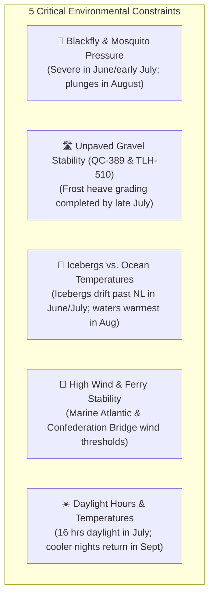

# Implementation Plan: Expedition 51 Weather Integration & Optimal Travel Window

## 1. Goal Description

This plan addresses two user requests:
1. **Seasonal Timing Analysis ("When is the best time to go?")**: Provide an in-depth climatological, road condition, and biological analysis to pinpoint the optimal calendar window for riding Expedition 51 on the Honda Africa Twin and Ducati Multistrada V2S.
2. **Weather in the Itinerary Feed**: Enhance each of the 15 daily stage cards in [`expedition_51_itinerary.html`](file:///C:/Users/Jamie/Desktop/Expedition%2051/expedition_51_itinerary.html) and [`index.html`](file:///C:/Users/Jamie/Desktop/Expedition%2051/index.html) with:
   - **Historical Climatology**: Curated 30-year historical climate averages (daytime highs, nighttime lows, precipitation probability, wind exposure, and maritime fog index) for the exact destination of each stage during the peak riding window.
   - **Live Weather Integration**: A zero-key, asynchronous client-side API integration using **Open-Meteo** that fetches real-time temperature, wind speed, weather icon, and precipitation forecast when connected to the internet, falling back gracefully to historical norms when offline.

---

## 2. When is the Best Time to Go? (Climatological & Rider Analysis)

Planning a 5,800+ km expedition spanning subarctic boreal forest (QC-389, TLH-500, TLH-510), the North Atlantic coast, the Gulf of St. Lawrence, and Maritime mountain ranges requires balancing five distinct environmental factors:



### Detailed Window Comparison:

| Window | Pros | Cons & Critical Risks | Overall Rating |
| :--- | :--- | :--- | :---: |
| **June 15 – July 10** *(Early Summer)* | • Maximum daylight (17 hrs)<br/>• Peak iceberg density off St. Anthony & Point Amour | ❌ **Severe blackfly swarms** in Labrador<br/>❌ QC-389 gravel often saturated/muddy from spring thaw<br/>❌ Nighttime temps near 0°C (32°F) in Labrador City & Churchill Falls<br/>❌ Dense freezing fog in Strait of Belle Isle | ⭐️⭐️ (Avoid) |
| **July 11 – July 24** *(Mid Summer)* | • Warmer daytime temperatures (20°C–24°C)<br/>• Roads dry out and are freshly graded<br/>• Icebergs still visible | ⚠️ Blackflies and horseflies still active in deep woods<br/>⚠️ Peak school holiday tourist congestion in PEI & Cabot Trail | ⭐️⭐️⭐️⭐️ (Good) |
| **July 25 – August 18** *(The Prime Sweet Spot)* | 🏆 **Optimal Road Conditions**: 158 km gravel detour on QC-389 is packed, dry, and fast.<br/>🏆 **Bug Collapse**: Blackfly season ends; mosquitoes greatly diminished.<br/>🏆 **Mild Subarctic Weather**: Day highs 18°C–22°C (64°F–72°F); overnight lows 8°C–12°C (46°F–54°F).<br/>🏆 **Warmest Ocean Surface**: Suppresses thick advection sea fog along coastal NL and Cabot Trail.<br/>🏆 **Confederation Bridge & Ferry Calm**: Lowest average storm frequency of the year. | • Icebergs mostly melted (except deep northern bays)<br/>• Requires early booking for Gros Morne and ferry cabins (October–January) | ⭐️⭐️⭐️⭐️⭐️ **(RECOMMENDED TARGET)** |
| **August 19 – September 5** *(Late Summer)* | • Virtually zero bugs<br/>• Crisp, clear riding days with vibrant early fall colors<br/>• Reduced tourist traffic | ⚠️ Atlantic hurricane remnants can bring nor'easters and heavy rain to Nova Scotia and Newfoundland<br/>⚠️ Shorter days (dusk by 8:00 PM)<br/>⚠️ Frost risk returns to western Labrador by early September | ⭐️⭐️⭐️⭐️ (Strong Backup) |

> [!IMPORTANT]
> **Recommended Target Departure Date**: **Saturday, July 26, 2025 (or August 2, 2025)**.
> This lands your ride across QC-389 and the Trans-Labrador Highway in early August during the driest, bug-free stretch of the season, puts you in Newfoundland during prime hiking weather, and crosses Prince Edward Island and Cape Breton when coastal waters are warmest.

---

## 3. Proposed Weather Architecture in the Feed

### Component Layout per Day Card

Each day card in the right-hand feed will receive a dedicated, interactive weather module:

```
┌────────────────────────────────────────────────────────────────────────┐
│ 🌤️ Weather Profile & Live Forecast                              [LIVE] │
├────────────────────────────────────────────────────────────────────────┤
│ 📊 Historical Norms (Late July / Early August):                        │
│   • High: 22°C (72°F)  |  Low: 11°C (52°F)  |  Rain Probability: 28%   │
│   • Wind / Hazards: Low risk inland; crosswinds on high bridges        │
│   • Recommended Layer: Mesh / vented textile jacket + thermal liner    │
├────────────────────────────────────────────────────────────────────────┤
│ 🔴 Live Forecast (Staging Destination):                                │
│   [Loading live satellite data via Open-Meteo...]                      │
│   e.g. ☀️ 21.4°C • Mostly Sunny • Wind: 14 km/h W • 0% Rain           │
└────────────────────────────────────────────────────────────────────────┘
```

### Stage-by-Stage Historical Climatology Reference Table

| Stage | Overnight Destination | Historical High | Historical Low | Rain Days / Month | Marine Wind / Fog Risk | Gear Recommendation |
| :---: | :--- | :---: | :---: | :---: | :---: | :--- |
| **D1** | **Mirabel / Saint-Jérôme, QC** | 26°C (79°F) | 15°C (59°F) | 9 days (28%) | Low | Vented summer gear; hydration pack |
| **D2** | **Baie-Comeau, QC** | 22°C (72°F) | 12°C (54°F) | 10 days (30%) | Moderate (St. Lawrence marine breeze) | Windproof mid-layer for river ferry |
| **D3** | **Labrador City, NL** | 20°C (68°F) | 8°C (46°F) | 12 days (38%) | Low to moderate | Full ADV textile with thermal mid-layer ready |
| **D4** | **Happy Valley-Goose Bay, NL**| 21°C (70°F) | 10°C (50°F) | 11 days (35%) | Low inland | Dust buff / neck gaiter for gravel |
| **D5** | **Blanc-Sablon / L'Anse-au-Clair**| 15°C (59°F)| 7°C (45°F) | 13 days (42%) | **HIGH** (Strait of Belle Isle sea fog) | Waterproof Gore-Tex outer + heated grips on |
| **D6** | **St. Anthony / Meadows, NL** | 16°C (61°F) | 8°C (46°F) | 12 days (40%) | Moderate (North Atlantic coastal) | Thermal base layer + fog visor treatment |
| **D7** | **Rocky Harbour (Gros Morne)** | 20°C (68°F) | 11°C (52°F) | 11 days (34%) | Moderate (Fjord microclimates) | Versatile layered modular gear |
| **D8** | **Gros Morne Exploration** | 20°C (68°F) | 11°C (52°F) | 11 days (34%) | Moderate | Lightweight hiking boots + rain shell in pannier |
| **D9** | **Port aux Basques / Ferry** | 18°C (64°F) | 11°C (52°F) | 11 days (35%) | **HIGH** (Wreckhouse crosswinds & marine gale)| Check wind alert before riding Codroy Valley |
| **D10**| **Baddeck / Cabot Trail, NS** | 24°C (75°F) | 14°C (57°F) | 9 days (29%) | High on coastal headlands | Modular textile; quick rain liner access |
| **D11**| **Charlottetown, PEI** | 24°C (75°F) | 15°C (59°F) | 8 days (26%) | Moderate (Bridge winds < 70 km/h) | Check Confederation Bridge wind app |
| **D12**| **Alma / Fundy National Park**| 22°C (72°F) | 13°C (55°F) | 9 days (29%) | **HIGH** (Bay of Fundy morning sea fog) | Fog wipes; clear visor for morning riding |
| **D13**| **Lévis, QC** | 25°C (77°F) | 14°C (57°F) | 10 days (32%) | Low (St. Lawrence valley) | Vented summer jacket |
| **D14**| **Pembroke, ON** | 26°C (79°F) | 14°C (57°F) | 9 days (28%) | Low (Ottawa Valley) | Mesh jacket with hydration |
| **D15**| **Hanmer, ON (Home)** | 25°C (77°F) | 13°C (55°F) | 9 days (28%) | Low | Home arrival comfort |

---

## 4. Live Weather API Engine (Open-Meteo Integration)

### Technical Design:
1. **API Endpoint**:
   `https://api.open-meteo.com/v1/forecast?latitude={lat}&longitude={lon}&current=temperature_2m,relative_humidity_2m,apparent_temperature,is_day,precipitation,weather_code,wind_speed_10m&timezone=auto`
2. **Keyless & CORS-Friendly**:
   Requires zero API keys, zero rate limits for personal/open-source usage, and allows direct browser client-side `fetch()`.
3. **WMO Weather Code Translation**:
   Converts WMO standard weather codes into rider-friendly weather emojis and descriptions (e.g. `0` = ☀️ Clear sky, `1-3` = ⛅ Partly cloudy, `45/48` = 🌫️ Fog, `51-65` = 🌧️ Rain, `80-82` = 🌦️ Rain showers, `95` = ⛈️ Thunderstorm).
4. **Caching & Asynchronous Loading**:
   Uses `sessionStorage` caching (30-minute expiry) to prevent redundant network requests and loads asynchronously so the map and itinerary remain 100% responsive instantly without waiting on network calls.

---

## 5. Verification Plan

### Automated DOM & Hierarchy Checks
```powershell
python scratch/verify_html_divs.py
```
* Verify `Total <div == Total </div` (`Diff: 0`).
* Verify section hierarchy (`body < data_pane < safety < downloads < fleet < script`).

### Functional UI Verification
* **Offline Resilience**: Verify that when disconnected from network or before API responds, historical climate averages (highs, lows, rain risk, gear advice) are immediately visible.
* **Live Weather Display**: Verify that when online, each stage card fetches live conditions for its destination city and renders a live badge (e.g. `☀️ 22°C • Clear • Wind: 12 km/h • Rain: 0%`).
* **Desktop / Mobile Responsiveness**: Verify that the weather container flows cleanly within the 46% data pane on desktop and stacks neatly on mobile viewports.

---

## User Review Required

> [!NOTE]
> Please review the recommended target departure window (**July 25 – August 18**) and let me know if you would like me to adjust the historical baseline or highlight any specific contingency dates. Once approved, I will proceed to implement the weather profiles and live Open-Meteo integration into `expedition_51_itinerary.html` and `index.html`.
