# Expedition 51: Pembroke $\rightarrow$ Portage-du-Fort $\rightarrow$ Route 148 $\rightarrow$ Mirabel Master Plan
### Realignment of Outbound Stages 1 & 2 • Complete Ottawa & Montreal Bypass • June 16–17, 2027

---

## Executive Summary & Tactical Rationale

In accordance with your direction, **Stage 1 (Wednesday, June 16, 2027)** and **Stage 2 (Thursday, June 17, 2027)** have been restructured to optimize riding quality, eliminate urban traffic bottlenecks, and balance saddle time:

1. **Elimination of Voyageur Provincial Park**:
   - Voyageur PP sat south of the Ottawa River right at the Ontario/Quebec border, forcing an awkward south-of-the-river terminus on Day 1 (656 km) and leaving an exhausting **785 km marathon on Day 2** to reach Baie-Comeau.
     - Moving the Night 1 halt to **Mirabel, QC** establishes an optimal balance:
      - **Stage 1 (Hanmer $\rightarrow$ Mirabel)**: **655 km** (~8h 00m saddle time).
      - **Stage 2 (Mirabel $\rightarrow$ Baie-Comeau)**: **709 km** (~9h 15m saddle time, saving ~76 km vs. Voyageur PP!).
2. **Portage-du-Fort Ottawa River Crossing**:
   - Departing Pembroke eastbound on Highway 17, riders cross the Ottawa River via **Chenaux Road (ON-653) across the historic Chenaux Generating Station dam** directly into **Portage-du-Fort, QC**.
   - This bypasses Highway 417 into Ottawa entirely.
3. **Route 148 (Pontiac & Outaouais Corridors)**:
   - Riders stay strictly on **Route 148 East** through the rolling agricultural Pontiac region (Shawville, Quyon, Luskville).
   - In Aylmer/Gatineau, the route utilizes **Boulevard des Allumettières (QC-148)** and transitions onto **Autoroute 50 East (Autoroute Guy-Lafleur)** through Gatineau to Masson-Angers (Du Ruisseau).
   - **Continuous Route 148 River Run (Du Ruisseau $\rightarrow$ Saint-Philippe $\rightarrow$ Lachute)**: From Du Ruisseau, the route leaves A-50 and remains 100% on scenic Highway 148 for 95 continuous kilometers through Masson-Angers, Lochaber, Thurso, Plaisance, Papineauville, Montebello, Fassett, Calumet, and Grenville all the way to **Saint-Philippe-d'Argenteuil**.
   - From Saint-Philippe, the route follows Route 148 / Rue Water directly into **Lachute**, connects onto **Route Sir-Wilfrid-Laurier (Route 158)** through Saint-Canut, and heads north onto Boulevard du Curé-Labelle (Route 117) straight to **Motel au P'tit Sapin** in Mirabel.
4. **100% Avoidance of Highway 40 & Big Cities**:
   - Uses **zero meters of Highway 40** between Montreal and Trois-Rivières (using scenic Route 158 through Joliette and historic **Chemin du Roy / Route 138** along the St. Lawrence River).
   - Bypasses downtown Montreal by over 40 km to the north.

---

## Stage Comparison Matrix: Before vs. After Realignment

| Metric | Voyageur PP Configuration (Old) | Mirabel Realignment (New) | Net Advantage |
| :--- | :---: | :---: | :--- |
| **Day 1 Route** | Hanmer $\rightarrow$ Pembroke $\rightarrow$ Ottawa Hwy 417 $\rightarrow$ Hull $\rightarrow$ Voyageur PP | Hanmer $\rightarrow$ Pembroke $\rightarrow$ Portage-du-Fort $\rightarrow$ Du Ruisseau $\rightarrow$ R-148 St-Philippe & Lachute $\rightarrow$ Mirabel | Completely avoids Ottawa & Hwy 417; scenic river & Laurentian valley cruise |
| **Day 1 Distance** | 656 km | **655 km** | Smooth 2-lane & 4-lane rolling highway |
| **Day 1 Lodging** | Voyageur PP tent campsite | **Motel au P'tit Sapin (Mirabel)** | Drive-up room-front bike parking, hot showers, rest |
| **Day 2 Route** | Voyageur PP $\rightarrow$ A-50 $\rightarrow$ R-158 $\rightarrow$ R-138 $\rightarrow$ Baie-Comeau | Mirabel $\rightarrow$ R-158 $\rightarrow$ R-138 $\rightarrow$ Charlevoix $\rightarrow$ Baie-Comeau | Shorter by ~76 km; fresher start |
| **Day 2 Distance** | 785 km (Exhausting) | **709 km** (Manageable) | **Reduces Day 2 saddle time by ~1h 45m!** |
| **Ottawa River Crossing** | Hwy 417 into central Ottawa $\rightarrow$ A-5 Hull | **Chenaux Dam into Portage-du-Fort** | Scenic hydro dam, zero capital gridlock |
| **Hwy 40 Monotony** | 0 km (Avoided) | **0 km (Strictly Avoided)** | Maintains 100% Chemin du Roy (R-138) |

---

## Detailed Turn-by-Turn Leg Routing

### Stage 1: Hanmer Home Base to Mirabel, QC (655 km • 8h 00m)
* **Date**: Wednesday, June 16, 2027
* **Start Point**: 4671 Dupuis Drive, Hanmer, ON (`46.6562, -80.8825`)
* **End Point**: Motel au P'tit Sapin, 16033 Bd Curé-Labelle, Mirabel, QC (`45.7346, -73.9668`)
* **Google Maps Navigation**: [Open Stage 1 Route ↗](https://maps.app.goo.gl/SjYN9qUtwYArBQfW7)

```mermaid
flowchart LR
    A["Hanmer Home Base<br>(4671 Dupuis Dr)"] -->|Hwy 17 East 145 km| B["North Bay<br>(Lake Nipissing)"]
    B -->|Hwy 17 East 215 km| C["Pembroke, ON<br>(Upper Ottawa Valley)"]
    C -->|Chenaux Dam 53 km| D["Portage-du-Fort, QC<br>(Enter Quebec)"]
    D -->|QC-148 East 40 km| E["Shawville & Quyon<br>(Pontiac Region)"]
    E -->|QC-148 East 43 km| F["Aylmer & Gatineau<br>(Maloney Est)"]
    F -->|A-50 East 24 km| G["Masson-Angers<br>(Chemin Pagé)"]
    G -->|Scenic R-148 95 km| H["Montebello, Fassett & Grenville<br>(Riverfront Corridor)"]
    H -->|R-148 to St-Philippe 15 km| I["Saint-Philippe & Lachute<br>(Rue Water / R-148)"]
    I -->|R-158 & R-117 25 km| J["Motel au P'tit Sapin<br>(Mirabel, QC)"]
```

#### Waypoint Cadence:
1. **Hanmer $\rightarrow$ North Bay (145 km)**: Trans-Canada Hwy 17 East rolling through Wahnapitae, Markstay-Warren, and Sturgeon Falls. Top up 91 Premium at Shell North Bay.
2. **North Bay $\rightarrow$ Pembroke (215 km)**: Scenic highway through Mattawa along the Ottawa River, passing through drift-wood forests and Deep River into Pembroke.
3. **Pembroke $\rightarrow$ Portage-du-Fort (53 km)**: East on Hwy 17 past Cobden to Haley Station; turn northeast onto Chenaux Road (ON-653) across the Chenaux Generating Station dam into Quebec onto QC-301 into Portage-du-Fort.
4. **Portage-du-Fort $\rightarrow$ Shawville & Quyon (40 km)**: Follow QC-301 to QC-148 East. Peaceful rural two-lane riding with zero commuter congestion.
5. **Quyon $\rightarrow$ Aylmer & Gatineau (57 km)**: Route 148 continues past Luskville into Aylmer via Boulevard des Allumettières and Boulevard Maloney Est. Connect onto Autoroute 50 East through Gatineau.
6. **Masson-Angers $\rightarrow$ Montebello $\rightarrow$ Fassett $\rightarrow$ Saint-Philippe (95 km)**: Rejoin Route 148 at Masson-Angers, following the river through Thurso, Plaisance, Papineauville, Montebello, Fassett, Calumet, and Grenville directly into **Saint-Philippe-d'Argenteuil**.
7. **Saint-Philippe $\rightarrow$ Lachute $\rightarrow$ Mirabel (40 km)**: Continue on Route 148 into Lachute via Rue Water, transition onto Route Sir-Wilfrid-Laurier (Route 158) through Saint-Canut, and turn north onto Boulevard du Curé-Labelle (Route 117) to **Motel au P'tit Sapin**.

---

### Stage 2: Mirabel, QC to Baie-Comeau, QC (709 km • 9h 15m)
* **Date**: Thursday, June 17, 2027
* **Start Point**: Motel au P'tit Sapin, Mirabel, QC (`45.7348, -73.9668`)
* **End Point**: Travelodge by Wyndham Baie-Comeau, QC (`49.2181, -68.1482`)
* **Google Maps Navigation**: [Open Stage 2 Route ↗](https://www.google.com/maps/dir/?api=1&origin=Motel+au+P%27tit+Sapin%2C+16033+Bd+Cur%C3%A9-Labelle%2C+Mirabel%2C+QC&destination=Travelodge+by+Wyndham+Baie-Comeau%2C+Baie-Comeau%2C+QC&waypoints=Joliette%2C+QC%7CBerthierville%2C+QC%7CTrois-Rivi%C3%A8res%2C+QC%7CRoute+138%2C+Sainte-Anne-de-Beaupr%C3%A9%2C+QC%7CBaie-Saint-Paul%2C+QC%7CTadoussac%2C+QC&travelmode=driving)

#### Waypoint Cadence:
1. **Mirabel $\rightarrow$ Saint-Jérôme $\rightarrow$ Joliette $\rightarrow$ Berthierville (95 km)**: North via Boulevard Curé-Labelle into Saint-Jérôme, then east along Route 158 through Joliette to Berthierville on the St. Lawrence River.
2. **Berthierville $\rightarrow$ Trois-Rivières (61 km)**: Join historic **Chemin du Roy (Route 138)** through Louiseville and Yamachiche, running parallel to the river and completely skipping Autoroute 40.
3. **Trois-Rivières $\rightarrow$ Quebec City / Côte-de-Beaupré (133 km)**: Follow Route 138 through Champlain, Batiscan, and Deschambault into Quebec City. Skirt downtown via Boulevard Sainte-Anne along the Côte-de-Beaupré cliffs past Montmorency Falls.
4. **Côte-de-Beaupré $\rightarrow$ Charlevoix mountains $\rightarrow$ La Malbaie (139 km)**: Ride scenic Route 362 through Baie-Saint-Paul, Les Éboulements, and Saint-Irénée over dramatic coastal roller-coaster switchbacks.
5. **La Malbaie $\rightarrow$ Baie-Sainte-Catherine $\rightarrow$ Tadoussac Ferry (75 km)**: Free 10-minute marine ferry crossing across the mouth of the Saguenay Fjord (beluga whale sightings).
6. **Tadoussac $\rightarrow$ Baie-Comeau (200 km)**: Route 138 North Shore wilderness cruising through Les Escoumins, Forestville, and Chute-aux-Outardes into Baie-Comeau.

---

## Curated Lodging Audit for Mirabel (Night 1)

| Tier | Property Name | Location / Address | Rate (CAD) | Phone | Motorcycle Perks & Tactical Features |
| :--- | :--- | :--- | :---: | :--- | :--- |
| **Tier 1 (Primary)** | **Motel au P'tit Sapin** | 16033 Bd Curé-Labelle, Mirabel, QC | ~$115/night | +1 450-432-4691 | Classic motor court with ground-level exterior drive-up room doors. Park bikes directly outside room window. Located right on Route 117 with rapid access to Route 158 East. |
| **Tier 2 (Fallback Hotel)** | **Motel Le Mirabeau** | 14209 Rue Leblanc, Mirabel (Saint-Canut), QC | ~$125/night | +1 450-432-0606 | Ground-level drive-up room doors; park bikes directly outside bedroom window. Heated, quiet, zero city noise. Direct Route 158 access. |
| **Tier 2 (Fallback Hotel)** | **Super 8 by Wyndham Saint-Jérôme / Mirabel** | 2455 Boulevard du Curé-Labelle, Saint-Jérôme, QC | ~$155/night | +1 450-438-4188 | Full-service hotel at Mirabel / Saint-Jérôme boundary off A-15 / R-117. Heated indoor pool, complimentary hot breakfast, lighted parking. |
| **Tier 3 (Campground)** | **Camping Mirabel** | 15975 Rue Saint-Augustin, Mirabel, QC | ~$42/night | +1 450-475-6903 | Wooded lakeside campground with hot showers, flush washrooms, and laundry facilities. Quiet rural setting. |

---

## Verified Deliverables Status

All expedition assets have been re-exported and validated:
- [x] **`scratch/road_tracks.json`**: 18 road-snapped tracks updated; Stage 1 end and Stage 2 start share exact coordinate `[-74.09058, 45.710042]` (0.000000m gap).
- [x] **`east_coast_adv_loop.gpx`**: 18 continuous tracks, 68 waypoints, 0m gap across all stages.
- [x] **`east_coast_adv_pois.csv`**: Day 1 updated with Motel Le Mirabeau, Super 8 Saint-Jérôme, Camping Mirabel, and Portage-du-Fort Ottawa River crossing.
- [x] **`expedition_51_itinerary.html` & `index.html`**: DIV audit `<div: 436, </div: 436, Diff: 0`, Node JS syntax validated, Leaflet map initializations 100% clean.
- [x] **`east_coast_moto_loop_map.html`**: Synced with all 18 tracks and 68 POIs.
- [x] **All Markdown Documentation**: Synchronized across Desktop and Brain workspaces.
